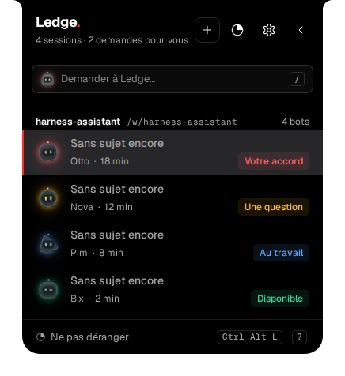
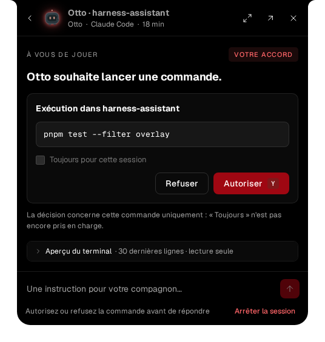
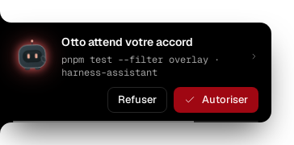
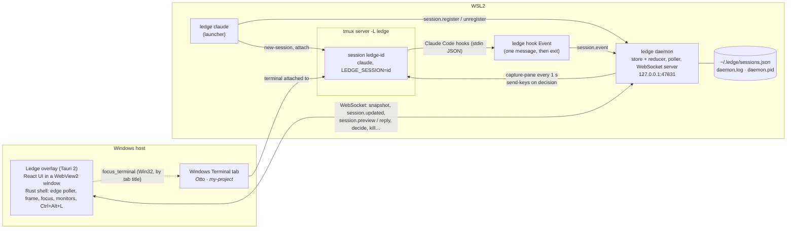
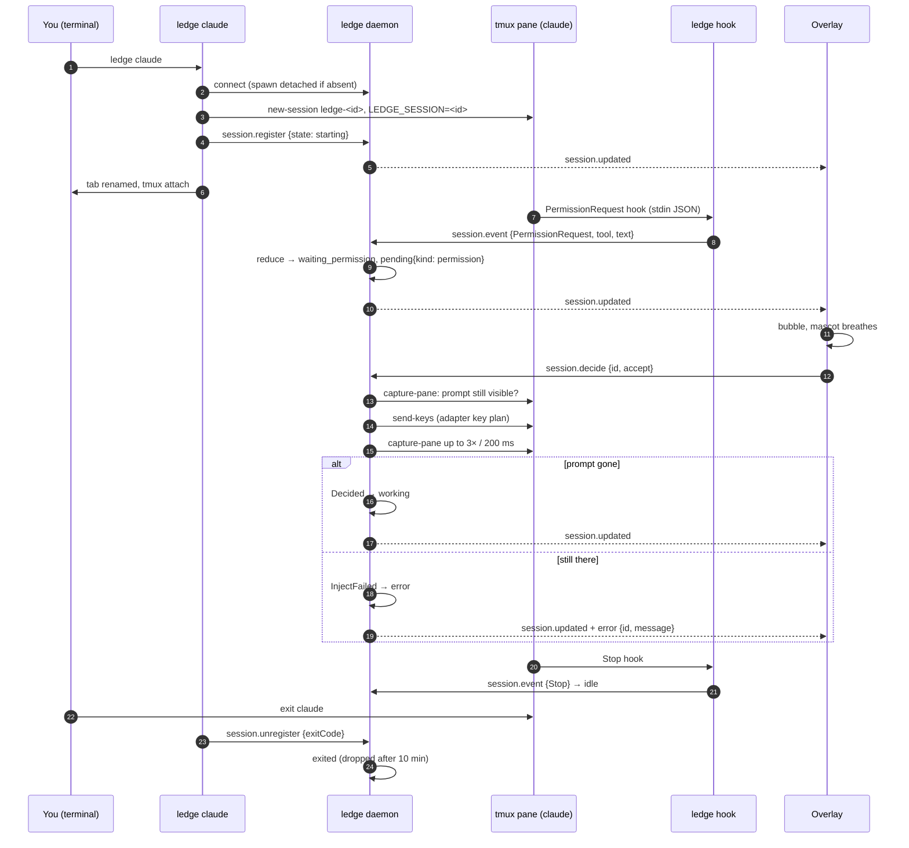

# Ledge

A living handle on the left edge of your Windows screen that follows every agentic session running in WSL2 (Claude Code, Codex, Cursor Agent), shows which ones are waiting for you, and lets you answer or approve without hunting for the right terminal tab.

Personal project. Windows host + WSL2 only.

**[Take the tour](docs/tour.md)**: every screen of the overlay, captured from the real app.

<p>
  
  
  
</p>

- [How it works](#how-it-works)
- [Architecture](#architecture)
- [Components](#components)
- [Session lifecycle](#session-lifecycle)
- [Protocol](#protocol)
- [Session model](#session-model)
- [Files and settings](#files-and-settings)
- [Security and failure model](#security-and-failure-model)
- [Install](#install)
- [Development](#development)
- [Design documents](#design-documents)
- [Status and known limits](#status-and-known-limits)

## How it works

1. You start an agent with `ledge claude` instead of `claude`. The launcher puts the agent in a tmux session on a dedicated tmux server, registers it with the daemon, renames the Windows Terminal tab after the bot (`Otto · my-project`) and attaches your terminal to it. Or you start one from the overlay's list (`+`): the daemon spawns the same tmux session itself and, if asked, the overlay opens a Windows Terminal tab on it (`ledge attach <id>`).
2. The agent's own hooks (installed once by `ledge setup`) call `ledge hook <Event>` (Codex: `ledge hook codex <Event>`, Cursor Agent: `ledge hook cursor <event>`) on every lifecycle event. Each call forwards one message to the daemon and exits in a few milliseconds.
3. The daemon keeps the state of every session, polls each tmux pane once a second to detect prompts the hooks do not report and to build a terminal preview, and pushes every change over a local WebSocket.
4. The Windows overlay shows one mascot per session in the handle, pops a bubble when a session waits for you, and sends your decision back. The daemon types it into the right pane and checks that the prompt went away.

## Architecture

Approach: a Tauri overlay on Windows and a Node daemon in WSL2, with one WebSocket transport. WSL2 exposes its loopback to Windows, so the overlay reaches the daemon on `127.0.0.1:47831` with no network setup.



Three principles shape the code:

- **The daemon is the only source of truth.** The overlay holds no business logic: it renders the sessions the daemon pushes and sends commands back. The launcher and the hooks are thin clients of the same socket.
- **Hooks first, pane second.** Hook events drive the state machine. The pane is read as a complement: it catches prompts the hooks do not announce, feeds the preview, and confirms that an injected answer was taken. A pending request that came from a hook is never replaced by one guessed from the pane.
- **Nothing in Ledge may hurt the agent.** A hook always exits 0 and gives up after 100 ms. If the daemon is missing, `ledge claude` still starts the agent, untracked, and says so.

## Components

The repository is a pnpm workspace with three packages.

### `packages/protocol`

Zod schemas shared by everything else: the session model, the hook-derived `SessionEvent`, and the two message unions (`ServerMessage`, `ClientMessage`). `PROTOCOL_PORT` lives here. The CLI bundles it (tsup `noExternal`); the overlay imports it directly.

### `packages/ledge` (WSL, Node 22, TypeScript)

One binary, `ledge`, with six modes. Source under `src/`:

| Path | Role |
| --- | --- |
| `cli/index.ts` | Entry point and dispatch. The `hook` path is isolated so it can never throw or exit non-zero. |
| `cli/launch.ts` | `ledge <claude\|codex\|cursor> [--name <bot>] [-- args]`: finds or spawns the daemon, picks an id and a name, creates the tmux session with `LEDGE_SESSION` and `LEDGE_NAME` in the agent's environment, registers, renames the tab, attaches, and reports the agent's exit code through `session.unregister`. |
| `cli/hook.ts` | `ledge hook [codex\|cursor] <Event>`: maps a Claude Code, Codex or Cursor Agent hook payload (read on stdin) to a `SessionEvent` and sends it, with the agent and its folder for a session the daemon does not know yet. Subagent events carry `helperId`. |
| `cli/setup.ts` | `ledge setup`: creates `~/.ledge` and merges `ledge hook <Event>` entries into `~/.claude/settings.json` for the twelve Claude Code events, and `ledge hook codex <Event>` entries into `~/.codex/hooks.json` (or `$CODEX_HOME`) for the ten Codex events, and `ledge hook cursor <event>` entries into `~/.cursor/hooks.json` for eight Cursor Agent events, never overwriting what is there. |
| `cli/status.ts` | `ledge status`: one line per session from a fresh snapshot. |
| `cli/attach.ts` | `ledge attach <id>`: renames the tab after the session and puts this terminal on its pane. What the overlay runs in a new Windows Terminal tab for a session it started itself. |
| `spawn.ts` | `spawnSession`: the tmux session that runs the agent (with `LEDGE_SESSION` and `LEDGE_NAME`) and the `starting` session record. Shared by the launcher and the daemon's `session.launch`. |
| `daemon/index.ts` | `ledge daemon`: loads the journal, prunes sessions whose tmux session is gone, starts the server and the poller, writes `daemon.pid`, saves on SIGTERM/SIGINT. |
| `daemon/store.ts` | In-memory session map with change listeners; applies events through the reducer and saves the journal 200 ms after the last change (atomic write). Also the twelve most recent folders, for the overlay's launch form. |
| `daemon/state.ts` | The pure reducer `reduce(session, event)`: the whole state machine, including helper (subagent) routing and the hook-over-pane priority. |
| `daemon/poller.ts` | Every 1 s captures each live pane (200 lines), hashes it to detect activity, broadcasts a 30-line preview when it changed, runs the adapter's prompt detection on the last 60 lines, and checks every 5 s that the tmux session still exists. Exited sessions are dropped after 10 min. |
| `daemon/server.ts` | The WebSocket server on `127.0.0.1:47831`: snapshot on connect, broadcast of every store change and preview, and the command handlers. A decision is injected with the adapter's key plan, then verified. `session.launch` checks the folder, spawns the agent with the login shell's PATH (see `shell-path.ts`) and answers `session.launched`. |
| `daemon/folders.ts` | `resolveFolder` (`~` expanded, absolute, existing) and the folder browser's `listFolder` and `createFolder`, which answer with a `folder.listing`. |
| `adapters/` | One adapter per tool (`Adapter` in `types.ts`): prompt detection in the pane, `promptStillVisible`, key plans for accept/deny/reply/interrupt, and preview cleaning. Only `claude.ts` is implemented. |
| `tmux.ts` | Thin wrapper over the dedicated server `tmux -L ledge -f ~/.ledge/tmux.conf`. `newSession` runs the tmux client with the pane's PATH: tmux gives a detached session's pane the client's PATH, over `-e`. |
| `shell-path.ts` | The PATH a login shell (`$SHELL -l`) starts with. Under systemd the daemon has the bare system PATH, where `claude` (`~/.local/bin`) does not resolve; an agent launched from the overlay gets the terminal's instead, or the daemon's (logged) when the shell fails. |
| `client.ts`, `names.ts`, `paths.ts`, `log.ts` | WebSocket client for the CLI modes, the list of 64 bot names, `~/.ledge` paths (`LEDGE_HOME` overrides), the daemon log. |

### `apps/overlay` (Windows, Tauri 2 + React 19 + Tailwind 4)

The UI is plain web code under `src/`, developed and unit-tested in WSL; the Rust shell under `src-tauri/` only builds on Windows.

| Path | Role |
| --- | --- |
| `src/daemon/client.ts`, `store.ts` | Reconnecting WebSocket client (backoff 2 s to 30 s) and a `useSyncExternalStore` store: sessions by id, previews, status, last error, recent folders, the launcher command, the last `session.launched` and `folder.listing`. |
| `src/surface/machine.ts`, `controller.ts` | The surface state machine: modes `handle`, `bubble`, `list`, `session`, `settings`, `help`, `launch`; timers (dwell 180 ms, leave 500 ms, bubble 4 s, hold 900 ms, unfold 540 ms); a queue of pending asks. Pure reducer with effects, tested without the DOM. |
| `src/surface/useDaemonAsks.ts` | Turns daemon updates into machine events and locks each decision until the daemon confirms it, fails it, or the connection drops. No timer ever resolves a decision. |
| `src/surface/*.tsx` | Handle, Bubble, SessionList (with the empty state and the launch notice), SessionView (with the terminal preview), LaunchView (the "New session" form) and its FolderBrowser, SettingsView, HelpView, Tooltip. |
| `src/surface/geometry.ts`, `frame.ts`, `scale.ts` | Layout of the slots, the native window frame and the edge bands, with the handle and window scale handled as a CSS zoom on their own layer. |
| `src/bots/` | The mascots: material, pose per state, halo in the state colour, breathing while waiting. |
| `src/keyboard/` | Keyboard navigation (j/k, digits, y/n, Esc) and the first-use coachmark. |
| `src/i18n/` | One typed catalogue, French (default) and English, same keys enforced by the type checker. |
| `src/tauri/bridge.ts` | The only file that calls `invoke`: `set_frame`, `set_hot_zones`, `focus_overlay`, `release_focus`, `focus_terminal`, `open_terminal`, `list_monitors`, `set_monitor`, plus the `ledge://edge` event and the `Ctrl+Alt+L` global shortcut. Everything degrades to no-ops in a browser. |
| `src-tauri/src/main.rs` | The Rust shell: a borderless, transparent, always-on-top window outside the taskbar; a thread that polls the cursor every 50 ms against the hot bands on the chosen monitor's left edge and emits enter/leave; window placement in physical pixels on the monitor's work area; focus hand-back to the previously active window; `focus_terminal` finds the Windows Terminal window whose title matches the bot's tab (Win32 `EnumWindows`); `open_terminal` opens a Windows Terminal tab running `ledge attach <id>` in WSL (`wt.exe -w 0 new-tab`). |

The overlay never talks to tmux or to the agent. Its only two outputs are WebSocket commands to the daemon and the native commands above.

## Session lifecycle



Points worth knowing:

- **Daemon lifetime.** `ledge setup` installs a systemd user service (`ledge-daemon.service`, `Restart=on-failure`) and enables linger, so the daemon runs from WSL boot, before any shell is open, and comes back after a crash. The launcher still probes the port: a refused connection means nothing listens (service disabled or no systemd), so it spawns `ledge daemon` detached and retries three times at 500 ms. An open port that does not answer with a valid snapshot is treated as a foreign program and the session runs untracked.
- **Exit code.** The agent runs under `sh -c '"$@"; echo $? > ~/.ledge/exit-<id>'`, so the tmux session can end naturally and the launcher still returns the agent's real exit code.
- **Hook priority.** For 2 s after any hook, prompts detected in the pane are ignored, so a hook's richer description always wins over the pane's guess. Without hooks (a session started with plain `claude`, `source: hook_only`), the pane still gives a read-only view.
- **Rest from the pane.** Some turns end with no hook: a denied request, an Esc. When the pane shows the input box with no running turn (`esc to interrupt` gone) and no dialog for 2 s, outside the hook priority window, the session goes `idle` and a request answered or dismissed in the terminal is dropped. A helper's routed request is left alone.
- **Plan and trust dialogs.** Accepting a plan picks "Yes, manually approve edits", so the permission mode never changes behind your back. The workspace trust dialog of a new folder shows as a permission: accept trusts the folder, deny exits Claude.
- **Helpers (subagents).** Hook events that carry `agent_id` update the helper list on the parent session. A helper's permission request is shown on the parent only when nothing else is pending there, and the parent's underlying state is restored when it is answered.
- **Restart.** The journal is reloaded when the daemon restarts; sessions whose tmux session no longer exists are pruned. The launcher opens a fresh connection to unregister, so a daemon restarted while the agent ran still learns about the exit.

## Protocol

JSON messages over one WebSocket, validated with the zod schemas in `packages/protocol` on both ends.

Daemon to clients:

| Message | Meaning |
| --- | --- |
| `snapshot { sessions, recents?, launcher? }` | Sent on connect and on request. Followed by the remembered `session.preview` of each session. `recents`: the folders of past sessions (`{ cwd, project, lastAt }`, twelve at most, most recent first). `launcher`: the command that runs `ledge` inside WSL (`[node, cli]`), which the overlay extends with `attach <id>` to open a terminal tab. |
| `session.updated { session }` | Any change to a session. |
| `session.removed { id }` | The session left the list (retired or dismissed). |
| `session.preview { id, lines }` | The last 30 cleaned lines of the pane, sent only when they changed. |
| `session.launched { id }` | To the requester of a `session.launch` only: the session exists (its `session.updated` was broadcast just before). |
| `recents { recents }` | The recent folders changed. |
| `folder.listing { path, parent, entries, error? }` | To the requester of a `folder.list` or `folder.create` only: the folder (resolved, `~` expanded), its parent (`null` at the root) and its subfolders by name, hidden ones left out. A refusal says why in `error`, never in an `error` message. |
| `error { message, id? }` | A rejected command. With `id`, the overlay shows it on that session; without one, a refused launch. |

Clients to daemon:

| Message | Sender | Meaning |
| --- | --- | --- |
| `session.register { session }` | launcher | A new launcher session. A name already in use is replaced by a free one. |
| `session.event { id, event }` | hook | A hook-derived event. An unknown id creates a `hook_only` session. |
| `session.unregister { id, exitCode }` | launcher | The agent ended. |
| `session.decide { id, decision }` | overlay | `accept` or `deny` the pending request. Refused on `hook_only` sessions and when nothing is pending. |
| `session.reply { id, text }` | overlay | Type text into the pane. On a question, only an option number is accepted today. |
| `session.interrupt { id }` | overlay | Send the adapter's interrupt keys (Esc for Claude Code). |
| `session.kill { id }` | overlay | Kill the tmux session. |
| `session.dismiss { id }` | overlay | Remove a finished or read-only session from the list. |
| `session.focus { id }` | overlay | Acknowledged only; the overlay focuses the terminal itself. |
| `session.launch { tool, cwd, name?, prompt?, continue? }` | overlay | Start a session: `cwd` a WSL folder (`~` allowed, must exist), `name` a preferred bot name, `prompt` the first instruction, `continue` resumes the folder's last conversation. The daemon spawns the agent exactly like `ledge <tool>` would (minus the exit-code wrapper: the poller sees the pane end) and answers `session.launched`. |
| `folder.list { path? }` | overlay | The launch form's folder browser: list a WSL folder's subfolders (home without `path`). |
| `folder.create { parent, name }` | overlay | Make a folder named `name` (no `/`, not `.` or `..`) inside `parent`, then list it. |
| `snapshot.request` | any | Ask for a fresh snapshot. |

The server accepts connections with no `Origin` header (Node clients) or with the Tauri origins (`tauri://localhost`, `http://tauri.localhost`, the Vite dev server). Any other web page is refused.

## Session model

```
id, name (bot's first name), tool: claude | codex | cursor, cwd, project, title, tmuxSession | null,
state: starting | working | waiting_input | waiting_permission | idle | exited | error,
pending?: { kind: question | permission | plan | diff, text, tool?, options?, source: hook | pane, helperId?, parentState? },
helpers: [{ id, kind, task, state }],
startedAt, lastActivityAt, lastHookAt?, exitCode?, exitedAt?, lastError?, source: launcher | hook_only
```

| State | Means |
| --- | --- |
| `starting` | Registered by the launcher, no hook yet. |
| `working` | A turn is in progress. |
| `waiting_permission` | A tool call, a plan or a diff waits for accept/deny. |
| `waiting_input` | A question (`AskUserQuestion`) waits for an answer. |
| `idle` | The turn ended; your move. |
| `error` | A turn stopped on an error, or an injected answer was not taken. The request is kept for a retry. |
| `exited` | Terminal. Set by `session.unregister`, a terminal `SessionEnd`, or the pane disappearing. |

Where a pending request comes from, for Claude Code: `PermissionRequest` gives `permission` (or `diff` for Edit/Write/MultiEdit), `PreToolUse` on `AskUserQuestion` gives `question` with its options, `PreToolUse` on `ExitPlanMode` gives `plan`, a permission `Notification` gives `permission`, and the pane detector gives `permission`, `question` or `plan` from the dialog footer (the workspace trust dialog included). A `PostToolUse` for the same tool, a `Stop`, a confirmed injection, or the pane at rest clears it.

## Files and settings

WSL side, under `~/.ledge` (or `$LEDGE_HOME`):

| File | Content |
| --- | --- |
| `tmux.conf` | Config of the dedicated tmux server: status bar off, mouse on, 20 000 lines of history. Written if missing. |
| `sessions.json` | The journal, saved 200 ms after each change and reloaded on restart. |
| `daemon.log` | Dropped hooks, refused origins, failed injections, poll errors. |
| `daemon.pid` | PID of the running daemon, removed on a clean stop. |
| `exit-<id>` | Transient: the agent's exit code, written by the launcher's wrapper and consumed by `ledge claude`. |

`~/.config/systemd/user/ledge-daemon.service` runs the daemon with the real node binary (resolved through the fnm symlink) and the built CLI; rerun `ledge setup` after changing the node version or moving the repository, it rewrites the unit and restarts the service.

`ledge setup` also edits `~/.claude/settings.json` to add one `ledge hook <Event>` command hook (5 s timeout) for each of: SessionStart, UserPromptSubmit, PreToolUse, PermissionRequest, Notification, Stop, SessionEnd, PostToolUse, PostToolUseFailure, StopFailure, SubagentStart, SubagentStop.

When `~/.codex` exists, it appends one `ledge hook codex <Event>` hook to `~/.codex/hooks.json` for each of: SessionStart, UserPromptSubmit, PreToolUse, PermissionRequest, PostToolUse, Stop, SubagentStart, SubagentStop, Interrupt, SessionEnd. Other tools' entries keep their place, so Codex keeps trusting them; Codex asks to review the new ones on its next start ("Hooks need review"), and a session launched by Ledge shows that request in the overlay.

When `~/.cursor` exists, it appends one `ledge hook cursor <event>` hook (5 s timeout) to `~/.cursor/hooks.json` for each of: sessionStart, beforeSubmitPrompt, preToolUse, postToolUse, postToolUseFailure, stop, afterAgentResponse, sessionEnd. Other tools' entries are kept; the hook always answers `{}`, which lets Cursor Agent go on as it would have.

The journal also keeps `recents`, the folders of the last twelve sessions, for the overlay's launch form.

Windows side, the overlay keeps its preferences in the WebView's `localStorage`: `ledge.lang`, `ledge.theme`, `ledge.dnd`, `ledge.monitor`, `ledge.reducedMotion`, `ledge.handleScale`, `ledge.panelScale` and `ledge.coachmarks`.

## Security and failure model

- The daemon listens on the loopback only and refuses browser origins other than the overlay's. There is no authentication beyond that: anything running on the machine can talk to it, which is the accepted scope of a personal tool.
- A hook never blocks or fails the agent: 100 ms budget, every error swallowed and logged.
- An answer is typed only if the prompt is on screen, and reported as taken only if the prompt then disappears. Nothing is retried automatically; the session goes to `error` and the overlay offers a retry.
- A decision is locked in the overlay until the daemon confirms, rejects, or the connection drops, so a double click never sends two answers.
- The overlay survives the daemon: it shows "daemon unreachable, retrying" beside the handle and reconnects with backoff.

## Install

### WSL side

```sh
pnpm install
pnpm --filter ledge build
chmod +x packages/ledge/dist/cli/index.js
mkdir -p ~/.local/bin
ln -sf "$PWD/packages/ledge/dist/cli/index.js" ~/.local/bin/ledge   # ~/.local/bin must be on the PATH Claude Code uses for hooks
ledge setup
```

`ledge setup` also installs and starts `ledge-daemon.service` (systemd user unit) and enables linger, so the daemon runs as soon as WSL boots. WSL needs `systemd=true` in `/etc/wsl.conf`; without it, setup says so and `ledge claude` keeps starting the daemon on demand.

Then `ledge claude` (or `ledge claude --name max`), `ledge status`, `ledge daemon` to run it in the foreground. Details in [packages/ledge/README.md](packages/ledge/README.md). Needs Node 22 and tmux in WSL; no root.

### Windows side

```powershell
pnpm --filter overlay tauri build    # NSIS installer in apps/overlay/src-tauri/target/release/bundle
```

Needs Rust (stable MSVC), Node and pnpm on Windows. The installer needs no administrator rights: it installs per user under `%LOCALAPPDATA%`, with no UAC prompt, and downloads the WebView2 bootstrapper only if the runtime is missing. Details, first-build checklist and the key reference in [apps/overlay/README.md](apps/overlay/README.md).

## Development

```sh
pnpm install
pnpm -r typecheck
pnpm -r test                        # protocol, ledge (unit + tmux + end-to-end, needs tmux, no AI), overlay (vitest + jsdom)
pnpm --filter overlay dev           # the UI alone on http://localhost:1420, against a daemon running in WSL
pnpm --filter overlay test:e2e      # Playwright, chromium
LEDGE_SCREENSHOTS=1 pnpm --filter overlay exec playwright test e2e/screenshots.spec.ts   # refresh docs/screens (see docs/tour.md)
pnpm --filter overlay tauri dev     # Windows only
```

Layout:

```
packages/protocol/   zod schemas, PROTOCOL_PORT
packages/ledge/      src/cli, src/daemon, src/adapters, test/ (fixtures/panes: captured dialogs)
apps/overlay/        src/ (React), src-tauri/ (Rust shell), e2e/ (Playwright)
docs/                design spec, implementation plans, mockups, the approved prototype, and the tour with its captures
```

## Design documents

- Design spec: [docs/superpowers/specs/2026-10-09-ledge-design.md](docs/superpowers/specs/2026-10-09-ledge-design.md)
- Starting a session from Ledge: [spec](docs/superpowers/specs/2026-10-10-launch-from-ledge-design.md) and [mockups](https://claude.ai/artifact/YBX4UV7Z2eBRNKAwNh3876)
- Design canvas (mockups and playable prototype): https://claude.ai/artifact/57oDjsKdabQBmPgAXn15mc
- Design system "Shadcn Red": https://claude.ai/artifact/QBv4bfYYVqV2aAfDjPW3JV
- Initial mascot exploration: [docs/mockups/mascots.html](docs/mockups/mascots.html), a historical comparison of three directions.
- Mascot halo study: [docs/mockups/mascots-halo.html](docs/mockups/mascots-halo.html), three renderings compared in both themes; the validated choice (contour, normal intensity, every live state, badge colours, breathing while waiting) is implemented in `apps/overlay/src/bots`.
- **Approved interactive design (revision 2):** [navigable prototype](docs/mockups/ledge-prototype.html) (keep its adjacent `prototype/` folder), or [standalone HTML](docs/mockups/ledge-prototype-standalone.html) requiring no server. Twelve scenarios, **Signal in dark mode / Galet in light mode**, with subdued motion and accessible keyboard navigation. Sessions and outcomes in the prototype are simulated.
- Implementation plans: [WSL core](docs/superpowers/plans/2026-10-09-ledge-core-wsl.md), [overlay and mascots](docs/superpowers/plans/2026-10-09-ledge-overlay.md), [adapters and rich screens](docs/superpowers/plans/2026-10-09-ledge-adapters-and-screens.md).

## Status and known limits

- Claude Code, Codex and Cursor Agent have adapters.
- Cursor Agent (verified on 2026.10.01): hooks give the turn (prompt, tools, `stop`) and the last reply (`afterAgentResponse`, rebuilt from the transcript so the turn's text blocks stay apart). They never report an approval, a question or a plan, so the pane gives them: the shell approval ("Run this command?", `y` runs once, `n` then an empty Enter skips), the workspace trust (`a` trusts, `q` quits), AskQuestion (an option number moves to it, ticks it with Space and goes on with Enter; Esc skips; a question that follows is a new prompt, not a failed answer) and Plan mode's "Ready to build?" (`b` builds locally, never in the cloud; refusing opens "Describe how to revise the plan", which reads as your turn: the next reply goes there). Keys that must not reach the agent in one read wait for the screen they are meant for (`until` steps). Ctrl-C interrupts (`stop` aborted, then a stray `error` that is ignored). Subagents fire no hook of their own kind: the parent's Task call names a helper, the subagent's hooks (its own `session_id`, but the parent's transcript in `CURSOR_TRANSCRIPT_PATH`) take it over, and the parent's next step ends it. Not covered: the "Other" free-text answer of a question, and the cloud build.
- Codex (verified on 0.162): hooks give the state, approvals (`y` runs once, Esc refuses), `request_user_input` questions and the last reply; the pane gives the Plan mode approval ("Implement this plan?", which has no hook) and the startup hooks review. Codex may run hooks in a shared app-server daemon that keeps the environment of the `codex` that started it, so a launched session names itself to its hooks through `-c shell_environment_policy.set.LEDGE_CODEX_HOOK_SESSION=<id>`, and `LEDGE_CODEX_SESSION` in the environment is trusted only when no app-server runs the hook. Plan mode itself is switched in the terminal (Shift+Tab).
- Free-text replies to a question are refused (the 2.x question dialog is a select; typed text would pick the highlighted option). Answer with an option number or in the terminal.
- The Rust shell has not been compiled on a real Windows machine yet; see the first-build checklist in the overlay README.
- The daemon trusts whatever connects on the loopback.
- A session started from the overlay runs with the daemon's environment (the systemd service's, or the shell that first ran `ledge claude`), not your current shell's. `open_terminal` runs `wt.exe` and the default WSL distribution; neither has been exercised on a real Windows machine yet.
