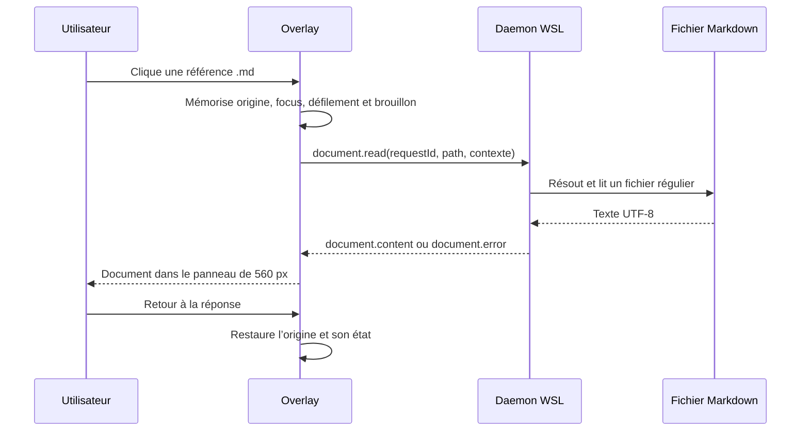

# Lecteur Markdown dans Ledge — design validé

Date : 2026-10-11. **Design visuel et parcours validés par l’utilisateur ; fonctionnalité à implémenter.** Les contrats techniques ci-dessous sont les choix proposés pour réaliser ce design, sans code produit livré dans cette étape.

## 1. Besoin et référence

Quand un agent ou un skill cite un fichier `.md`, l’utilisateur doit pouvoir le lire immédiatement dans Ledge : README, plan Superpowers, design ou `SKILL.md`. Il revient ensuite à la conversation pour poser une question ou donner son accord.

La référence validée est la **seconde maquette, fondée sur les composants existants** :

- [Maquette autonome](../../mockups/ledge-reader-existing.html), ouvrable dans un navigateur Windows sans serveur.
- [Capture de la session](../../mockups/ledge-reader-existing-session.png) et [capture du lecteur](../../mockups/ledge-reader-existing-reader.png).
- [Sources de la maquette](../../mockups/reader-existing/main.tsx). Reconstruction : `node docs/mockups/reader-existing/build.mjs`, depuis la racine du dépôt.
- [Plan d’implémentation](../plans/2026-10-11-markdown-reader.md).

La première étude `ledge-markdown-reader.html`, avec une session et un lecteur côte à côte, est historique. **La version à réaliser remplace le contenu du panneau existant par le document.** Le bureau, le terminal et les commandes de démonstration à droite de la seconde maquette ne font pas partie du produit.

## 2. Parcours validé

1. L’utilisateur ouvre la session d’Otto dans le panneau actuel, large de 480 px à l’échelle 1.
2. La réponse contient un lien vers un fichier Markdown. Son texte reste celui fourni par l’agent : nom du fichier, chemin ou intitulé.
3. Un clic ouvre le document dans **le même panneau**, qui passe à 560 px. L’en-tête conserve la mascotte et l’origine du document.
4. L’utilisateur fait défiler le document, déplie le sommaire, consulte la source Markdown ou agrandit le lecteur.
5. La flèche, « Retour à la réponse » ou Échap ramène à la session, à sa position précédente, avec son brouillon intact.
6. La croix replie Ledge vers la poignée. Elle ne signifie ni retour ni approbation.

Lire un plan ne déclenche aucun `session.reply`, `session.decide`, appel de modèle ou lancement de commande. Les cases à cocher du document restent en lecture seule.

## 3. Géométrie et rendu

| Élément | Décision |
| --- | --- |
| Ancrage | Bord gauche du moniteur choisi, même surface noire/blanche et mêmes `Shoulders` |
| Largeurs de base | Session 480 px ; lecteur 560 px ; lecteur agrandi 800 px ; poignée 28 px |
| Hauteur du lecteur | `min(760, screenH / panelScale - 2 * SIZES.margin)` en unités de base ; `SIZES.margin = 40` |
| Placement | Centré verticalement, borné à la zone de travail ; respecte le moniteur et l’échelle des panneaux |
| Petit écran | Borner la largeur à la zone de travail disponible, ombre comprise ; aucune largeur déduite de la petite fenêtre native actuelle |
| En-tête | 60 px ; retour, mascotte, titre, origine, agrandir/réduire, replier |
| Chemin | Dossier puis nom du fichier en Geist Mono ; chemin complet accessible au survol et sélectionnable |
| Barre d’outils | Lecture / Markdown, Sommaire, mention « Lecture seule » |
| Sommaire | Replié au départ, ouvert dans le panneau au-dessus du document ; replié après sélection |
| Corps | Texte 14 px / 22 px, marges 24 px ; titre principal 23 px / 30 px ; lignes limitées à une colonne de 720 px maximum |
| Pied | 46 px, retour et rappel d’Échap ; reste visible pendant le défilement |

Utiliser `tokens.css`, `Button`, `Icon`, `Bot`, `ResidentMascot`, `Shoulders` et les transitions existantes. Pas de nouvelle palette ni de système de mouvements. Le rendu suit clair/sombre, langue FR/EN, mouvement réduit et `panelScale`.

L’agrandissement est un passage à 800 px dans la surface, pas une nouvelle fenêtre ni le plein écran du navigateur. Échap revient à l’origine même lorsque le lecteur est agrandi. Un Échap ferme d’abord le sommaire s’il est ouvert.

L’en-tête garde le nom du fichier jusqu’à ce qu’un titre de document soit disponible. Il n’invente ni auteur, ni badge « validé », ni durée de lecture. Les mentions Superpowers présentes dans la maquette sont du contenu d’exemple.

## 4. Périmètre de la première version

### Points d’entrée

- Dernière réponse d’une session, dans `SessionView` / `ReplyCard`, y compris les chemins affichés comme code inline.
- Réponse du chat Ledge dans `ChatView`, avec retour au même tour et au même brouillon.
- Liens Markdown vers un autre `.md` depuis un document déjà ouvert.
- Les blocs de code et l’aperçu brut du terminal restent du texte : aucune transformation de commandes en liens.

Dans le chat, un chemin relatif nécessite une origine connue. Si plusieurs sessions peuvent être concernées, afficher « Impossible de déterminer le dossier de ce document » ; ne jamais choisir le premier dépôt de la liste. Les chemins absolus et `~/…` restent utilisables.

### Fichiers et références

Accepter `.md` et `.markdown`, sans distinction de casse, notamment `README.md` et `SKILL.md` :

- Liens Markdown explicites, chemins inline entre backticks et chemins nus sans espaces.
- Chemins avec espaces lorsqu’ils sont délimités par un lien Markdown ou du code inline.
- Chemins WSL absolus, `~/…`, chemins relatifs au `cwd` de la session ; liens d’un document relatifs au dossier de ce document.
- Suffixes `:42`, `:42:7`, `#L42` et ancres `#nom-du-titre`. Une ligne ouvre la vue Markdown à cette ligne ; une ancre ouvre la vue Lecture au titre.
- Un lien HTTPS finissant par `.md` reste un lien web ouvert par le mécanisme existant ; il n’est pas téléchargé par le daemon.

Ne pas chercher un fichier homonyme dans tous les dépôts ni parcourir les caches de skills. Un `SKILL.md` externe fonctionne grâce au chemin absolu fourni par l’agent. Les chemins Windows `C:\…`, UNC et les URI `file:` ne sont pas convertis en V1 ; afficher une explication si un lien explicite les vise. Les références doivent désigner le système de fichiers de la distribution WSL du daemon.

### Rendu Markdown

Conserver le document : titres H1–H6, paragraphes, emphases, listes imbriquées, listes numérotées, tâches désactivées, citations, tableaux, blocs de code avec langage, règles et liens. Le sommaire suit les titres, y compris les titres répétés et accentués. Aucune classification « faits / questions / suite » n’est appliquée au document.

Utiliser un rendu dédié avec `react-markdown` et `remark-gfm` dans l’overlay. Le premier rend du Markdown via des composants React ; le second ajoute notamment les tableaux et listes de tâches. Sources primaires : [react-markdown](https://github.com/remarkjs/react-markdown), [remark-gfm](https://github.com/remarkjs/remark-gfm), consultées le 2026-10-11. Fixer les versions compatibles dans le lockfile lors de l’implémentation ; aucun ajout de dépendance pendant la documentation.

Le rendu n’exécute pas de HTML, JavaScript, MDX ni de commandes. Échapper le HTML brut, ne pas ajouter `rehype-raw`, ne pas injecter le contenu via `dangerouslySetInnerHTML`. Les URL dangereuses ne deviennent pas des liens. Désactiver le chargement d’images distantes ou locales : afficher leur texte alternatif et leur référence ; l’asset loader est hors V1. Mermaid reste un bloc de code. Le frontmatter reste visible comme texte/code, sans devenir un titre ou une règle isolée. L’onglet Markdown présente **le texte lu**, et non un texte reconstruit depuis le rendu.

### Limites volontaires

Pas d’édition, annotations, validation de plan, recherche globale, index de fichiers, synchronisation en direct, export, coloration syntaxique ou réglage supplémentaire de taille du texte en V1. Le réglage d’échelle de Ledge reste applicable. Une action discrète « Recharger » relit explicitement le fichier ; un changement sur disque ne déplace jamais spontanément la lecture.

## 5. Architecture proposée



### Lecture côté daemon

L’overlay Windows ne lit pas directement un chemin Linux. Ajouter un service `packages/ledge/src/daemon/documents.ts`, appelé depuis `server.ts`. Il reçoit un chemin uniquement après une action utilisateur, lit avec les droits du compte WSL et ne lance aucun shell. Un `.md` hors dépôt, comme un skill dans `~/.codex/plugins/…`, est autorisé ; la lecture n’est pas limitée à `cwd`.

Résolution : `basePath` (fichier source d’un lien interne) > `sessionId` et son `cwd` > erreur `ambiguous_path` pour un relatif. Les absolus et `~/…` n’ont pas besoin de base. Si un `sessionId` fourni n’existe plus, renvoyer `session_missing`. `basePath` doit être absolu et désigner un Markdown. Conserver le chemin absolu résolu pour les liens relatifs ; suivre les symlinks pour lire la cible, vérifier que c’est un fichier régulier, refuser périphériques, sockets, répertoires et FIFO sans bloquer leur ouverture.

Limite V1 : **1 048 576 octets (1 Mio)**, lecture bornée à limite + 1 octet même si le fichier grossit. Décodage UTF-8 strict, BOM initial accepté. Pas de troncature silencieuse. La configuration actuelle d’origine WebSocket continue de s’appliquer ; ne pas autoriser les pages web arbitraires pour cette fonctionnalité.

### Contrat de protocole

Ajouter les schémas à `packages/protocol/src/documents.ts`, puis aux unions de `messages.ts` et aux exports d’`index.ts` :

```ts
type DocumentRead = {
  type: 'document.read'; requestId: string; path: string;
  sessionId?: string; basePath?: string;
};
type DocumentContent = {
  type: 'document.content'; requestId: string; path: string;
  text: string; bytes: number; modifiedAt: string;
};
type DocumentErrorCode = 'not_found' | 'not_file' | 'unsupported_path'
  | 'unsupported_type' | 'permission_denied' | 'too_large' | 'invalid_utf8'
  | 'ambiguous_path' | 'session_missing' | 'read_failed';
type DocumentError = {
  type: 'document.error'; requestId: string; path: string;
  code: DocumentErrorCode;
};
```

`requestId` est non vide et unique par tentative. `path`/`basePath` sont limités à 4 096 caractères. `modifiedAt` est une date ISO ; `bytes` est le nombre d’octets effectivement lus. La réponse est envoyée uniquement au socket demandeur ; pas de contenu documentaire dans le snapshot ou dans le journal. Les erreurs documentaires n’utilisent pas le message générique `error`, déjà associé aux actions de session/lancement.

### État du lecteur

Ajouter un mode `reader` à la machine de surface. Séparer son cycle de vie dans `useDocumentReader.ts` : origine `{ kind: 'session', sessionId } | { kind: 'chat' }`, pile de documents, sélection active, requête en cours, vue Lecture/Markdown, agrandissement et scroll. La machine gère ouvrir/retour/replier et la géométrie, pas le texte.

Un `document.read` se corrèle par `requestId` : ouvrir B puis recevoir A ne remplace pas B. Un hook raccordé à `client.onMessage` peut porter cet état sans ajouter le texte au store global des sessions. Délai de réponse : **10 secondes** ; ensuite afficher une erreur réessayable et ignorer la réponse tardive. Fermeture, nouvelle ouverture et démontage invalident les réponses devenues obsolètes.

En revenant depuis un lien vers un autre Markdown, dépiler vers le document précédent ; depuis le premier document, revenir à l’origine. Échap suit la même règle. Conserver la position et la vue de chaque entrée de la pile. À la fermeture par la croix, purger la pile et les requêtes ; conserver les brouillons existants des sessions. La réouverture d’un fichier depuis la conversation relit le disque.

Conserver la vue source montée mais inactive, ou mémoriser explicitement scroll/focus/brouillon avant démontage. Les couches cachées doivent être `inert`. Au retour, restaurer le focus sur le lien d’origine, ou sur l’en-tête si ce lien a disparu. Un nouveau tour de l’agent peut modifier la session en arrière-plan ; il ne ferme pas le lecteur. Les nouvelles demandes restent dans la file, sans voler la lecture.

Si la session source disparaît, le texte déjà chargé reste lisible ; le retour aboutit à la liste. Si la connexion tombe, conserver le document déjà chargé avec une indication hors ligne ; bloquer nouvelle lecture/rechargement jusqu’au rétablissement. Ni retour, ni rechargement ne rejouent une action d’agent.

## 6. Clavier, erreurs et fenêtre Windows

- Lecture possible au clavier : Tab, activation des liens, sommaire, sélection/copier du texte, défilement et Échap. Les raccourcis `Y`, `N`, chiffres et `R` d’une session ne doivent pas agir depuis le lecteur.
- Chargement : en-tête et chemin immédiats, message « Lecture du document… », retour disponible.
- Erreur : chemin tenté et cause compréhensible en FR/EN. « Réessayer » pour les erreurs de lecture ; « Revenir à la réponse » toujours disponible. Fichier vide : « Ce document est vide ».
- Ancres ou numéros de ligne inexistants : conserver le document au début, indiquer que la position demandée n’existe pas.
- `geometry.ts`, `frameOf`, `useNativeFrame` et les zones interactives doivent inclure le lecteur et sa transition. Le lecteur ne se replie pas au simple départ du pointeur.
- La largeur maximale doit venir de la **zone de travail du moniteur**, en unités logiques cohérentes avec `panelScale`. Ajouter la largeur de travail à l’information native si nécessaire ; `window.innerWidth` dans Tauri est la fenêtre actuelle, pas le moniteur.

## 7. Acceptation

- [ ] Depuis un vrai plan Superpowers cité par une session, ouvrir le fichier présent sur disque WSL en un clic.
- [ ] Ouvrir un `SKILL.md` absolu situé hors du dépôt ; résoudre un relatif depuis le bon `cwd`, y compris un worktree.
- [ ] Session 480 px → lecteur 560 px → agrandi 800 px → retour, à l’échelle 1, sans couper contenu ni ombre.
- [ ] Revenir au même brouillon, à la même position et au lien initial ; aucun message envoyé à l’agent.
- [ ] Lire titres, listes, tableaux, code, tâches et source brute ; sommaire utilisable avec titres répétés.
- [ ] Gérer fichier absent/vide/trop grand, perte de connexion et réponses arrivant dans le désordre.
- [ ] Vérifier clair/sombre, FR/EN, clavier, mouvement réduit, moniteurs et échelles 100/150/200 %.
- [ ] Contrôler réellement sur Windows la fenêtre Tauri, ses transitions et sa capture du pointeur ; la maquette navigateur ne prouve pas ce comportement natif.

## 8. Handoff

Le design approuvé est conservé ici pour une réalisation ultérieure. Les exemples de la maquette sont des fixtures : ne pas copier ses données, ses chemins `ledge://preview/…`, son HTML préfabriqué ou son interception globale des clics dans le produit. L’implémentation doit connecter les références réelles au daemon et au renderer dédié décrit ci-dessus.
