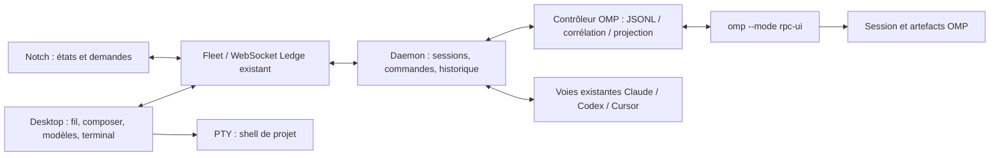

# OMP dans Ledge — intégration native RPC

2026-10-20. **Implémenté (#63, lots 1 à 5) et vérifié sur OMP 18.12.3.** Écarts assumés par rapport au texte ci-dessous : le texte progressif passe par des cartes `session.thread.item` mises à jour toutes les 120 ms (pas d'événement delta dédié) ; Ask Ledge tourne aussi sur OMP (`omp -p --mode json`, outils `read,grep,glob`) et OMP peut être l'agent par défaut, sur décision de Joffrey (§2, ligne « Ask Ledge »).

## 1. Décision proposée

Ajouter **OMP comme quatrième harness**, piloté par le daemon via son protocole JSONL. Réutiliser les parcours et composants actuels de Ledge, plutôt que construire une application OMP dans l’application.

- Le fil, les décisions, le modèle et les états proviennent du RPC, jamais du texte d’un terminal.
- Décision utilisateur : pour OMP, **aucun suivi terminal ni bascule TUI**. Seul le shell libre du projet reste disponible à côté du fil ; le contrôle de la conversation reste natif.
- Claude Code, Codex et Cursor conservent leur fonctionnement actuel. Il ne s’agit pas de remplacer globalement tmux.
- La mascotte OMP retenue est le **π asymétrique avec les yeux Ledge**, issu de la [proposition validée](https://github.com/Lyssaen/ledge/commit/0972d66f79172e87ced9258a4ce242c514cf821f), suivie par [l’issue #61](https://github.com/Lyssaen/ledge/issues/61). L’identité visuelle ne vaut pas support du harness.

### Références de travail

Le code analysé est le `main` distant **[f5e6014](https://github.com/Lyssaen/ledge/tree/f5e601453532455e0940d727d0ae21520c3c55de)**, pas la branche locale de la galerie, plus ancienne. Les chemins de code ci-dessous se rapportent à ce commit. Le README historique décrit encore un overlay séparé ; le code actuel utilise Ledge Desktop et son notch.

OMP installé et exercé : **18.12.3**. Contrats consultés : [RPC](omp://rpc.md), [autorisations](omp://approval-mode.md), [sessions](omp://session-operations-export-share-fork-resume.md), [providers](omp://providers.md), [Collab](omp://collab.md). Les garanties documentaires sont distinguées des vérifications exécutées en §10.

## 2. Partir de l’existant, sans surpromesse

| Parcours Ledge actuel | Adaptation OMP proposée | Limite à respecter |
| --- | --- | --- |
| Création : harness, machine, projet/dossier, modèle, effort, premier message | Ajouter OMP au même formulaire ; catalogue fourni par l’OMP de la machine cible ; `--add-dir` pour les dossiers supplémentaires | Aucun modèle ni abonnement codé en dur dans le front |
| Conversation et actions regroupées, résultats d’outils, fichiers/diffs | Alimenter les mêmes cartes depuis les événements RPC ; texte affiché pendant la génération | Le flux de texte incrémental nécessite un contrat nouveau ; le lecteur de transcript Claude ne sait pas lire OMP |
| Question, permission, plan, diff en attente | Réutiliser les cartes et la bulle du notch ; répondre au `requestId` natif | Les dialogues génériques OMP ne portent pas tous une catégorie sémantique permission/plan |
| Modèle modifiable en cours de session, `modelNext` | Garder l’UX « au prochain moment libre » ; appliquer `set_model` et l’effort par RPC | Ne pas arrêter/redémarrer OMP comme le chemin actuel des autres harnesses |
| Sidebar, atelier, projets, helpers, états du notch | Même session Ledge ; sous-agents issus du registre OMP | Un sous-agent OMP n’est ni une nouvelle session tmux ni une nouvelle session utilisateur |
| Renommer, archiver, restaurer, reprendre, supprimer | Conserver ces parcours ; reprise par le fichier de session exact | « Restaurer dans la liste » reste différent de « relancer l’agent » |
| Messages entre sessions et relais du chat | Réutiliser la boîte d’envoi Ledge et son attribution ; livrer via RPC pour les cibles OMP | Une commande admise n’est pas une preuve de lecture par l’agent |
| Terminal intégré, onglets shell, terminal externe | Pour OMP, conserver uniquement le shell libre du projet | Aucun onglet de suivi d’agent, `attach`, reprise TUI ou faux terminal alimenté par le fil |
| Ask Ledge, assistant de lecture transversal | Lire les sessions OMP via les données normalisées comme les autres | Faire tourner Ask Ledge *avec OMP* est un chemin d’exécution distinct, pas une conséquence automatique de l’ajout du harness |

Les pièces jointes natives, le rendu du raisonnement, le fork de conversation et les commandes avancées OMP ne sont **pas déjà présents** dans les schémas de session de Ledge. Ne pas les présenter comme une simple activation de fonctions existantes. Le design prévoit leurs points d’entrée, sans en faire des prérequis du remplacement du suivi terminal.

## 3. Parcours visibles

### 3.1 Créer une session

Dans `LaunchComposer`, conserver les champs existants. La maquette intégrée reprend l’ordre du formulaire du prototype desktop : **consigne**, **harness et modèle/effort**, puis **projet, machine et dépôts**, avec le résumé et le lancement dans le pied de modale. Le choix du harness reste compact tant que l’utilisateur ne demande pas à le modifier ; pas de nouveau parcours plein écran.

- Le harness préféré est présélectionné à chaque nouvelle session. S’il est indisponible sur la machine cible, conserver la préférence mais bloquer le lancement avec une raison explicite ; l’utilisateur choisit une alternative, jamais de repli automatique. La liste distingue le choix ponctuel et le défaut. Modifier le défaut ne remplace pas le harness du brouillon en cours.
- Le modèle est identifié sans ambiguïté par `provider/modelId`. Le picker existant peut afficher le fournisseur dans le libellé/description ; pas de page de gestion de modèles parallèle.
- « Par défaut OMP » garde le choix effectif de la configuration OMP ; après lancement, afficher le modèle réellement renvoyé par `get_state`.
- Les niveaux de raisonnement sont ceux du modèle sélectionné. Le RPC découvre ceux du modèle actif ; ne pas appliquer à tout le catalogue les niveaux découverts pour le modèle courant. Avant lancement, conserver l’effort par défaut quand les capacités du modèle choisi ne sont pas connues ; permettre ensuite la sélection native.
- Aligner le formulaire et la carte de lancement du chat sur [l’issue #62](https://github.com/Lyssaen/ledge/issues/62) : puce modèle/effort, recherche sur nom/identifiant/description, compteur de résultats, identifiant exact valide et effort dans le pied de liste. Choisir un modèle garde la liste ouverte ; Échap la ferme sans fermer le formulaire/chat. Les valeurs ressemblant à des options CLI, dont `-p`, ne sont pas proposées comme identifiants. Masquer la puce pour un daemon `outdated`, sans conserver un choix explicite non pris en charge.
- Proposition de réglage explicite : **« Autorisations : demander avant les écritures et exécutions »**, correspondant à `--approval-mode always-ask`. OMP a un défaut `yolo` ; ne pas hériter de cette différence sans la rendre visible. Le réglage ne promet aucun sandbox système.
- Pour OMP, seul le shell libre reste ouvrable/masquable selon le panneau existant. Créer une session ne dépend pas d’un shell ouvert.

Les comptes restent gérés par OMP. Ledge ne copie pas les tokens ni `agent.db`. Un catalogue disponible est une indication de configuration, pas une vérification de quota ou de droit d’inférence.

### 3.2 Travailler dans la session

Réutiliser `Workspace`, le fil, les groupes d’actions et le composer.

- En-tête : nom de session, OMP, modèle/effort, état. Le détail technique « Contrôle natif » appartient à un indicateur discret ou au menu, pas à un nouvel écran.
- Au repos, « Envoyer » transmet un `prompt`. Pendant le travail, proposer **« Après ce tour »** par défaut et **« Réorienter maintenant »** explicitement : `follow_up` et `steer`, qui n’ont pas la même sémantique.
- Ajouter un bouton **« Interrompre »** au composer quand OMP travaille. `session.interrupt` existe dans le protocole, mais le parcours Desktop inspecté ne fournit pas déjà ce bouton.
- Un accusé de commande signifie « instruction reçue/mise en file ». Le texte final vient du flux ; la disponibilité générale de la session vient de `session_settled`/`isSettled`.
- La file visible se réconcilie avec `queue_update` et `get_state.queuedMessages`, pas avec une estimation du front. Les mêmes messages ne doivent pas attendre à la fois dans la file du daemon et dans celle d’OMP.
- Les sorties d’outils gardent leurs cartes et statuts ; les données inconnues ont une présentation textuelle sûre, sans suppression silencieuse. Une écriture n’apparaît dans « Changements » qu’après un résultat qui en confirme la réussite ; ne pas déduire un diff complet d’un simple nom de fichier.

### 3.3 Répondre à une demande

Conserver l’entrée dans le fil et l’alerte du notch ; permettre d’ouvrir la demande complète dans Desktop.

- `ask` : toutes les questions d’un appel, leurs descriptions, recommandations, réponses multiples et champ libre. Ce n’est pas une série de touches à simuler.
- `select` : options exactes et descriptions fournies par OMP. Ne pas inventer « Toujours autoriser » ou transformer une portée fichier en portée session.
- `confirm` : confirmation/refus ; `input` et `editor` : champ simple ou multiligne.
- Une demande générique est affichée comme **« OMP attend une réponse »** si aucune métadonnée fiable ne prouve qu’il s’agit d’une permission. Ni regex sur un titre ni traduction des labels pour décider de l’autorisation.
- Une réponse venant du Desktop ou du notch verrouille le même identifiant de demande ; l’autre vue se met à jour. Aucun double envoi.
- Plusieurs demandes peuvent coexister, notamment avec des helpers : le daemon garde une collection ; la carte prioritaire/première et un compteur alimentent les surfaces compactes. Ne pas écraser le deuxième dialogue dans l’unique `Session.pending` actuel.

**Limite native importante :** `extension_ui_response` n’a pas d’ACK RPC ; un identifiant inconnu est ignoré. Afficher « réponse envoyée », puis réconcilier avec les événements réellement observés. Un write réussi sur stdin ne prouve pas qu’un outil a été autorisé/exécuté. Conserver un état indéterminé en cas de rupture entre l’envoi et la suite du flux ; ne pas rejouer automatiquement.

Sur `cancel {targetId}`, fermer la demande concernée. Ledge n’ajoute aucun minuteur qui répond à la place de l’utilisateur. Attention : le timeout natif d’un `ask` OMP peut choisir la recommandation ou la première option. Cette expiration doit être signalée comme comportement du harness, jamais attribuée à une décision utilisateur. Annuler volontairement utilise `cancelled: true` sans prétendre à un timeout.

### 3.4 Changer de modèle

Réutiliser `SessionModel` et `modelNext`.

1. L’utilisateur choisit un modèle et éventuellement un effort.
2. Si une génération, un dialogue ou une opération de session est actif, garder le choix « au prochain moment libre ».
3. Quand `isSettled` est vrai, qu’aucune demande ne reste ouverte et que le contrôleur possède la session, appliquer `set_model`, puis découvrir/valider l’effort et appliquer `set_thinking_level` si demandé.
4. Relire `get_state` et afficher l’état effectif. Les commandes ne sont pas une transaction atomique : si le modèle change mais que l’effort est refusé, afficher le nouveau modèle et l’erreur d’effort, sans prétendre avoir conservé l’ancien ensemble.
5. Un choix invalide ne détruit ni la conversation ni le processus. Aucun changement implicite de fournisseur pour contourner une erreur d’authentification ou de quota.

### 3.5 Shell libre uniquement pour OMP

Décision utilisateur : supprimer le suivi terminal OMP et la bascule vers sa TUI. Le panneau existant conserve **le shell libre du projet**, utilisable en parallèle du contrôle natif : Git, tests, `omp login` et maintenance.

- Le shell n’est jamais une source d’état de la conversation.
- Pour une session OMP, ne pas afficher d’onglet « terminal de l’agent », de prévisualisation de pane ou d’action `attach`.
- Ne jamais lancer automatiquement un second `omp --resume` depuis le bouton terminal.
- Ouvrir, masquer ou fermer le shell ne transfère pas le contrôle de la session et n’arrête pas son processus RPC.
- Une fonction OMP non exposée dans Ledge reste explicitement indisponible ; ne pas promettre un recours à la TUI sur la même conversation. La configuration extérieure à la conversation peut se faire dans le shell.
- Les autres harnesses conservent leurs terminaux actuels. Aucun bridge Collab ni partage réseau n’est nécessaire.

## 4. Architecture du daemon

### Choix techniques

- **Un processus OMP par session Ledge active**, possédé par le daemon de la machine cible. Pas un processus partagé entre plusieurs conversations, ni un processus Node dans le front.
- Un module spécifique `daemon/omp/` : transport/corrélation, cycle de vie, projection des événements. Ces noms sont proposés, pas des fichiers déjà existants. Ne pas faire entrer OMP dans l’interface d’adaptateur `keysFor/detectPrompt`.
- Point de dispatch explicite selon le backend de session. Les routes tmux continuent à fonctionner pour les trois harnesses actuels ; le poller, les titres tmux, `PaneGone` et le prune au démarrage ignorent le backend OMP RPC.
- Conserver `Session.id` Ledge à travers les reprises. Stocker séparément `agentSessionId`, le fichier OMP exact et une génération de processus. Ne jamais utiliser un nom de bot ou un PID seul comme identité durable.
- Réutiliser le login-shell environment, l’authentification du WebSocket et le routage machine existants. Le binaire, les credentials et les fichiers de session appartiennent à la machine cible.

### Démarrage

Invocation de principe : `omp --mode rpc-ui --session-dir <répertoire-de-cette-session> --cwd <cwd> --approval-mode <choix-explicite>`, avec modèle/dossiers éventuels. En production, ne pas ajouter les drapeaux de sonde qui désactivent outils/extensions.

**Pas de `--no-ui`** : même en `rpc-ui`, ce drapeau supprime les dialogues d’approbation provenant des extensions ; les appels concernés échouent au lieu d’envoyer une carte.

Ordre du handshake :

1. Capturer stdout dès le spawn ; stderr séparé et borné, jamais mélangé au JSONL.
2. Attendre `ready`. Négocier le protocole 2 quand annoncé, avant de traiter les gros contenus.
3. Activer `set_ask_dialog`, le filtre `messageUpdates: "delta"` et `set_subagent_subscription` selon les capacités prouvées. Une commande refusée désactive sa capacité ; une réponse au handshake ne prouve pas tous les sous-protocoles.
4. Lire `get_state`, l’identité réelle et l’historique nécessaire ; installer les projections et les demandes reçues pendant le démarrage.
5. Annoncer une session utilisable ; envoyer ensuite le premier prompt. Un dialogue de démarrage doit rester accessible avant l’état utilisable, sinon l’initialisation se bloque.

OMP peut partager une configuration globale avec le terminal ; Ledge ne réécrit pas `config.yml` pour piloter une session. La reprise emploie `--resume <fichier>` ; `open_session` choisit le plus récent non vide d’un répertoire et n’est donc pas une reprise exacte lorsqu’on connaît déjà le fichier.

### Robustesse du transport

- C’est du **JSONL spécifique OMP**, pas JSON-RPC 2.0. Identifiant unique pour chaque commande, corrélation par `id`, jamais par ordre des réponses.
- Valider les limites annoncées, réassembler `rpc_chunk` en v2 avec ordre, taille et UTF-8 stricts. Évaluer le décodeur officiel exporté et sa compatibilité Node/tsup avant de réimplémenter ; ne pas importer tout le runtime OMP dans Ledge pour un décodeur.
- Un frame invalide/incomplet ou un dépassement ne devient pas une conversation partiellement « réussie ». Signaler le problème et resynchroniser ou fermer selon sa gravité.
- Drainer stdout indépendamment de la vitesse d’affichage. Ne pas conserver des snapshots complets à chaque token. OMP peut spooler sur disque sous backpressure : le daemon doit continuer à lire même quand le front est fermé.
- `response.success`, `prompt_result` et `session_settled` ont trois rôles différents. Aucune notification de fin sur le premier `agent_end` si des tâches peuvent relancer l’agent.

## 5. Contrats Ledge à faire évoluer

Les noms ci-dessous sont des **contrats proposés**, à implémenter dans `packages/protocol` puis à migrer dans tous les consommateurs concernés.

### Session, capacités, demandes

- Ajouter `omp` à `ToolSchema` et aux tables exhaustives (launch, modèles, libellés, préférences, fleet, chat/routing concernés). L’ajout visuel à `Bot` n’a pas modifié le protocole.
- Ajouter un backend explicite (`tmux` ou `omp-rpc`) et un état de récupération du contrôle natif. Aucun mode de bascule `handoff/terminal` pour OMP. `source: launcher/hook_only` reste une provenance, pas un transport.
- Ajouter les capacités **par harness et par machine**, puis leur disponibilité effective par session : lancement, modèles, changement à chaud, flux, réponses structurées, interruption, sous-agents, shell libre et terminal d’agent (désactivé pour OMP). Ne pas utiliser les seuls booléens globaux `daemon.models/modelSwitch` pour annoncer toutes les capacités OMP.
- Étendre la provenance des demandes pour le RPC. Ajouter des demandes natives typées `select/confirm/input/editor/ask`, leur identifiant et génération, options exactes, timeout annoncé et état d’envoi. Une collection conserve les demandes simultanées ; `pending` peut rester la projection prioritaire pour les surfaces compactes, pas une deuxième source de vérité.
- Une commande de réponse structurée porte l’identité de la session, la génération, le `requestId`, une clé de contenu attendue et la réponse validée. Le daemon refuse toute demande périmée ou déjà traitée. Les anciens clients ne doivent pas pouvoir répondre à une nouvelle demande avec une approximation accept/deny.
- Distinguer les capacités « session OMP » et « Ask Ledge exécuté par OMP ». Ne pas laisser l’ajout de l’enum rendre ce dernier sélectionnable sans runner et garanties de lecture seule.

### Fil streamable

Conserver `session.thread` (snapshot) et `session.thread.item` (création/finalisation d’une carte).

Ajouter un événement delta de texte ciblé, avec `itemId`, bloc/segment, génération du fil et séquence. Le daemon accumule les deltas OMP par `messageId` et `contentIndex`, en petites fenêtres d’envoi ; la carte finale remplace l’accumulation. Pas de remplacement de tout le fil pour chaque token.

- Snapshot et deltas ont un curseur cohérent : après reconnexion, réinstaller le snapshot, puis accepter seulement les deltas postérieurs de la même génération. Ne pas additionner un snapshot complet et les tokens qu’il contient déjà.
- Un `message_end` est la version complète de référence de ce message ; `agent_end.messages` peut être compacté et n’est pas l’historique complet.
- Les blocs `thinking` restent distincts de la réponse si exposés : rendu repliable additionnel, jamais de raisonnement inventé quand le modèle n’en fournit pas. Le schéma actuel ne contient pas encore cet item.
- Les outils utilisent `toolCallId` et leur statut, pas leur position dans une liste. Conserver l’attribution des helpers et distinguer notice système, message d’agent et prompt utilisateur.
- Pour les todos, projeter le `todoPhases` natif ; ne pas faire semblant qu’OMP émet un `TodoWrite` Claude.
- Ne pas confondre un identifiant de message live et un identifiant d’entrée durable sans garantie du protocole. Une reconstruction après crash remplace la projection concernée, elle ne concatène pas aveuglément deux historiques.

### Historique et synchronisation

Le journal OMP est la référence de la conversation ; le store/historique Ledge conserve la projection nécessaire à ses écrans et à la reconnexion. Ne pas journaliser chaque token comme un nouvel item.

- Au repos, utiliser `get_messages_page` avec ses curseurs ; `session_busy` et `stale_cursor` imposent de recommencer une lecture cohérente, pas de mélanger les pages.
- Pendant le travail, servir le snapshot du daemon alimenté depuis le début du flux. À une reprise de processus, hydrater avant d’envoyer un nouveau prompt.
- `get_entries` donne l’append-history, pas seulement la branche active. Une reconstruction doit respecter `leafId`/la branche ; un appel monolithique ne convient pas à un historique arbitrairement gros.
- La limite actuelle de projection Ledge (`History`, 400 items) n’est pas une limite de la session OMP. Signaler la fenêtre affichée ; ne pas supprimer l’historique du harness quand les cartes sortent du cache Ledge.
- Les liens `artifact://` et chemins locaux passent par une résolution bornée à la session/machine et les lecteurs existants ; ne pas transmettre une commande RPC arbitraire depuis un lien Markdown.

## 6. États, arrêt, reprise

| Fait natif | Projection Ledge |
| --- | --- |
| Processus en initialisation / synchronisation | `starting`, avec diagnostic si le handshake échoue |
| `agent_start`, exécution d’outil, compaction ou travail asynchrone restant | `working` ; conserver une indication d’activité adaptée |
| Demande UI réellement ouverte | `waiting_input`, ou `waiting_permission` seulement si sa nature est connue |
| `prompt_result` | État de cette instruction, succès/erreur/abandon ; pas nécessairement repos de la session |
| `session_settled` ou état natif quiescent, sans demande ouverte | `idle`, conversation disponible ; pas `exited` |
| Processus fermé volontairement | `exited`, avec code de sortie ; conversation conservée |
| Rupture inattendue / persistance en erreur | Erreur/interruption explicite ; historique gardé, reprise proposée |

Le renderer doit montrer la récupération ou la perte de connexion avant de colorer un état de travail ancien. Un `get_state` isolé ne suffit pas à reconstruire les demandes UI : elles sont conservées par le daemon qui reçoit le flux.

- `abort` interrompt le travail mais ne signifie pas « tuer la session ». Ne pas supposer qu’il vide toutes les files ; resynchroniser l’état. L’action explicite « interrompre et récupérer la file » peut utiliser `abort_and_restore_queue` et conserver le brouillon retourné.
- Archiver/supprimer doit fermer le propriétaire RPC aussi bien que tmux, invalider les demandes et conserver la sémantique existante sur les transcripts. Ne pas supprimer les fichiers OMP de l’utilisateur par effet implicite d’un retrait de carte Ledge.
- Une coupure Desktop↔daemon n’arrête pas OMP. Les commandes potentiellement admises ne sont pas renvoyées automatiquement après reconnexion ; leur incertitude doit être visible.
- Un redémarrage du daemon est différent : il possède les pipes OMP. Ne pas promettre que le processus survit et reste contrôlable comme un pane tmux. Étendre la garde d’auto-update aux sessions OMP vivantes ; préférer différer la mise à jour à interrompre une session.
- Après crash du daemon, vérifier/terminer le propriétaire résiduel avant toute reprise, puis proposer de reprendre le fichier exact. Ne pas utiliser `--restore` automatiquement : cette option peut poursuivre du travail interrompu et relancer des sous-agents. Une reprise ne doit pas rejouer une décision ni une commande à effets de bord sans action utilisateur.

## 7. Abonnements, permissions et sécurité

- Réutiliser le profil/auth store OMP de l’utilisateur sur chaque machine. Aucun token dans le WebSocket, les snapshots, le journal de diagnostic ou les commandes affichées.
- `get_available_models` filtre la disponibilité configurée ; cela ne valide pas une clé, un abonnement ni le quota réel. Le smoke local expose 115 modèles répartis entre `anthropic`, `openai-codex` et `cursor` ; ce nombre n’est ni un contrat ni une liste à embarquer.
- Le flux `login` sait ouvrir une URL OAuth et répondre à certaines demandes non secrètes ; les saisies secrètes sont refusées par RPC. Le shell `omp login` reste donc une vraie fonction de secours. Ne pas capturer une clé dans un champ texte générique.
- L’authentification MCP interactive n’est pas disponible de manière équivalente dans les deux modes RPC. Afficher le besoin de configuration terminal, plutôt que promettre qu’un simple mode `rpc-ui` le résout.
- Aucun `--auto-approve`/`--yolo` injecté pour contourner une intégration incomplète. Respecter les refus explicites et toutes les portées natives.
- Le caractère « lecture seule » d’Ask Ledge exige un runner/outillage limité et une politique dédiée ; `always-ask` n’est pas une garantie de lecture seule et `--no-tools` ne neutralise pas arbitrairement toute extension.
- Les événements, Markdown, résultats et descriptions de plugins sont du contenu non fiable. Ils ne déclenchent ni shell, ni ouverture automatique de fichier/URL sensible, ni élévation de droits.

## 8. Points d’intégration concrets

| Zone du code au commit de référence | Intervention |
| --- | --- |
| `packages/protocol/src/{session,messages,models,thread,decisions}.ts` | Quatrième harness, backend/capacités, demandes natives, commandes corrélées et deltas |
| `packages/ledge/src/{spawn,cli/launch,cli/attach}.ts` | Dispatch tmux/RPC et propriété du processus ; refuser l’attache terminal à une session OMP RPC |
| `packages/ledge/src/daemon/{server,state,store,history}.ts` | Routage des actions, projection RPC, demandes simultanées, état et reprise |
| `packages/ledge/src/daemon/{poller,models,mailbox}.ts` | Exclure RPC du scraping, catalogue OMP, livraison native attribuée |
| `packages/ledge/src/daemon/index.ts`, `update/guard.ts` | Prune et auto-update conscients des processus RPC, récupération après crash |
| `packages/fleet/src/{fleet,machines,decisions}.ts` et store/client concernés | Routage machine, capacités, deltas et demandes sur Desktop/notch |
| `apps/desktop/src/launch/{LaunchComposer,model,ModelPicker}.tsx/ts` | Option OMP, modèles et autorisations sans nouveau parcours de création |
| `apps/desktop/src/session/{Workspace,SessionModel,PendingCard,Reply,useThread,TermPane}.tsx/ts` | Fil natif, réponses riches, interruption/file ; shell libre uniquement pour OMP |
| `apps/desktop/src/term/{mode,store}.ts` | Shell indépendant, sans onglet de suivi d’agent OMP ; ne plus interpréter « pas de tmux » comme « session hors de Ledge » pour OMP |
| `apps/desktop/src/session/{exchanges,todos}.ts`, composants de fil et i18n | Noms d’outils OMP, todos et attribution ; textes français/anglais |
| `packages/ui/src/bots/` | Mascotte π validée, dépendance visuelle de l’issue #61 |

Les chemins regroupés `.tsx/ts` désignent les modules de cette zone, pas une instruction de renommer leurs extensions. Les tables exhaustives et tous leurs consommateurs devront être migrés, sans alias rétrocompatible « OMP = Claude ».

## 9. Ordre d’implémentation et critères de sortie

Lots techniques, **pas réduction du comportement cible** :

1. **Contrats + propriétaire RPC** : lancement/reprise exacte, handshake, état, persistance, capacités, arrêt et garde de mise à jour. Conserver le fonctionnement des trois harnesses existants.
2. **Parcours natif complet** : fil streamable, résultats d’outils, composer, file, interruption, demandes structurées/approbations, changement de modèle, reconnexion et helpers. Une conversation ordinaire doit pouvoir se faire sans ouvrir le terminal.
3. **Parité Ledge + shell libre** : archives/reprises/renommage, messages et relais, notifications/notch, shell indépendant et erreurs d’authentification clairement exposées.

Avant de déclarer l’intégration complète :

- Lancer OMP depuis Desktop, envoyer une instruction, voir arriver texte/outils, répondre à une question multiple et à une véritable approbation sans touches terminal.
- Montrer qu’une instruction admise, une réponse terminée et une session quiescente ont des états distincts ; un helper encore actif ne déclenche pas de fausse notification de fin.
- Modifier le modèle sans perdre l’identité/historique ni redémarrer le processus ; traiter l’échec partiel modèle/effort.
- Répondre simultanément depuis deux fronts ; une seule réponse atteint une demande toujours valide. Expiration, annulation et déconnexion n’autorisent rien implicitement côté Ledge.
- Reconnecter le front pendant un stream sans doubler le texte ni rejouer le prompt ; reprendre après arrêt du daemon sans doublon d’outils ni deuxième écrivain.
- Utiliser le shell en parallèle sans changer l’état de l’agent ; ne montrer aucun suivi terminal OMP et ne lancer aucun second processus sur sa conversation.
- Tester une vraie autorisation OMP et son refus, un changement de modèle inter-provider en cours de conversation, une réponse volumineuse chunkée, ainsi qu’un échec de persistance. Aucun de ces points n’est validé par un simple catalogue de modèles.

Fonctions OMP supplémentaires (fork/arbre, images, hub avancé, voix, tools/URI fournis par Ledge) : ne pas les activer implicitement. Les garder identifiées comme fonctions nouvelles ; le catalogue ne garantit pas que toutes les commandes interactives sont disponibles en RPC.

## 10. Vérifications exécutées et limites

Sondes temporaires sur le **vrai binaire OMP 18.12.3**, sans patch du daemon ni de l’application :

| Scénario exécuté | Résultat observé |
| --- | --- |
| `omp --version`, `--help` | Version, modes `rpc/rpc-ui`, options session/approval confirmés |
| Démarrage RPC UI isolé, `ready`, négociation v2 | Protocole 2 accepté ; limites annoncées 1 MiB physique et 64 MiB réassemblé |
| `get_state`, `set_ask_dialog`, filtre delta, abonnement subagents | Réponses de succès ; état initial quiescent |
| Extension temporaire avec commande locale ouvrant `confirm` puis `select` | Deux demandes reçues, réponses consommées ; notification finale avec `confirmed: true`, `selected: Second` ; `prompt_result` local `agentInvoked: false` |
| Catalogue, `set_model` sur le modèle déjà actif, efforts | 115 modèles / trois providers configurés ; sélection et découverte acceptées, sans preuve d’inférence |
| Historique paginé vide, commande RPC inconnue, commande suivante | Page vide valide ; erreur corrélée et processus encore utilisable |
| Session persistante : création, nom, état/entrées, EOF puis nouveau processus `--resume <fichier>` | Même `sessionId`, même fichier, nom et entrées conservés ; deux sorties 0, sans stderr |
| Fermeture du premier smoke | Sortie 0, aucun stderr ; stdout drainé |

Le catalogue RPC ne listait pas `collab`. Une sonde `/collab status` envoyée malgré cette absence a été admise comme prompt et a émis `agent_start` avant fermeture, pas un résultat de commande Collab. **Leçon de conception : ne pas envoyer une commande non découverte en présumant qu’elle sera refusée localement.** Cette sonde ne prouve ni support Collab en RPC ni absence d’appel provider ; aucune réponse de modèle n’a été observée dans ce parcours.

Non exercés : génération complète avec un modèle, droits/quotas réels des abonnements, véritable appel d’outil soumis à approbation, multi-question `ask`, crash/reprise en cours d’outil, chunks volumineux, MCP/OAuth, shell natif Windows et rendu de la future UI. Les événements de stream et ces comportements sont ici des contrats documentés ou des critères de validation, pas des preuves de fonctionnement de Ledge.

### Décisions produit

- **Validé :** contrôle OMP natif, suivi terminal désactivé, shell libre uniquement. La proposition antérieure de bascule TUI est abandonnée.
- **Proposé :** politique d’autorisations explicite au lancement.
- **Maquette de sélection du harness :** `/launch-harness.html`, sur le serveur de prévisualisation de `packages/ui`. Un défaut est présélectionné à chaque nouvelle session ; une sélection ponctuelle ne modifie pas ce défaut. « Définir par défaut » est une action séparée. Le projet et le brouillon survivent au changement de harness ; le modèle revient au défaut du nouveau harness. La préférence de cette maquette est isolée dans le navigateur, pas dans les réglages réels de Ledge.
- La maquette réutilise les mascottes validées et les tokens de Ledge ; ses modèles sont des exemples, ses lancements des simulations. Scénarios vérifiés dans le navigateur : override sans mutation du défaut, changement explicite et persistance après rechargement, application à la session suivante, annulation des préférences, conservation projet/brouillon, modèle réinitialisé, indisponibilité sans repli, validation du brouillon vide et absence de débordement horizontal à 390 px. Vérification TypeScript du package UI réussie.

### Maquette replacée dans le parcours existant — issue #62

`docs/mockups/ledge-harness-integration.html#launch` est généré par `node docs/mockups/session-management/build.mjs`. Il étend **le prototype desktop existant de gestion des sessions**, pas une capture de l’application de production actuelle : navigation, atelier, modale, réglages Général, page de session et chat latéral sont conservés. Les composants partagés de contrôle et les mascottes approuvées sont réutilisés ; les adaptations de chat et du menu modèle restent locales à la maquette. Le menu suit le design de `ModelMenu` livré avec #58, complété par #62. Le HTML précédent de gestion des sessions et l’étude isolée `/launch-harness.html` ne sont pas remplacés.

- **Réglages → Général :** quatre harnesses ; Claude reste le défaut initial. La préférence est isolée sous `ledge.mockup.harness-integration.default`. Le prochain formulaire prend le défaut ; un choix ponctuel ou une annulation ne le modifie pas.
- **Nouvelle session :** ouverture compacte, choix explicite par mascotte, action séparée « Définir par défaut », modèle/effort réinitialisés lors d’un changement de harness. Dans ce scénario, OMP est disponible sur PC local et indisponible sur Dev SSH ; aucun repli automatique.
- **Chat Ledge :** demander « Lance 2 agents Codex pour corriger les tests du daemon ». La carte utilise le même menu que le formulaire. Les deux sessions simulées conservent modèle et effort ; le reçu dépliable montre le même `qid` pour chaque proposition de `session.launch`. « Scénarios de la maquette » permet de simuler un daemon ancien : puce masquée et choix explicites retirés.
- **Session OMP :** identité et modèle/effort dans le contexte existant ; action « Shell libre », sans `ledge attach`, sortie d’agent synthétisée ni bascule TUI. Une commande tapée dans le shell indique qu’elle n’a pas été exécutée.

Vérifications exécutées : génération du HTML par esbuild, puis parcours réels dans Chromium. Défaut depuis le formulaire et depuis Général, persistance après rechargement, override annulé, consigne/projet conservés, modèle réinitialisé, indisponibilité OMP bloquante ; recherche par nom/identifiant/description, ↑/↓/Entrée, Échap depuis le compteur à sa borne, effort, identifiant hors catalogue, rejet de `-p`, deux lancements simulés avec modèle/effort et `qid`, daemon ancien sans choix résiduel, ouverture du shell OMP depuis le formulaire et le chat. Inspection visuelle sombre/clair, menu au-dessus et au-dessous de sa puce, redimensionnement et largeur 390 px sans débordement horizontal du parcours vérifié.

Limites : petits catalogues d’exemple, pas de découverte réelle des modèles, pas de transport `session.launch` ni de RPC OMP. Les reçus sont des états locaux, **pas une preuve d’envoi au daemon**. Les composants transversaux de mentions/relais du chat gardent leur schéma de production à trois harnesses ; les cartes OMP utilisent leur reçu local. L’issue #62 reste ouverte jusqu’à son implémentation et sa validation dans l’application réelle.
