# Teams in Ledge: overview of the three specs

Date: 2026-10-26. Status: design.

| Spec | What it adds |
| --- | --- |
| [Roles, teams and Ledge as their operator](2026-10-25-roles-teams-operator-design.md) | Roles, team templates, live teams, Ledge as a task giver, the `ledge-team` and `ledge-task` cards, `@role`, autonomy, the TUI |
| [The atelier's rooms](2026-10-26-atelier-rooms-design.md) | One room per project with low walls, one table per team, the common table, joining and leaving by drag |
| [Ledge as the home view](2026-10-26-ledge-home-design.md) | Ask Ledge becomes the home view: « Le point », tabs, live cards, a richer composer |

Mockups (captured from the real Ledge Desktop and `ledge tui` against their simulated daemons, then edited):

  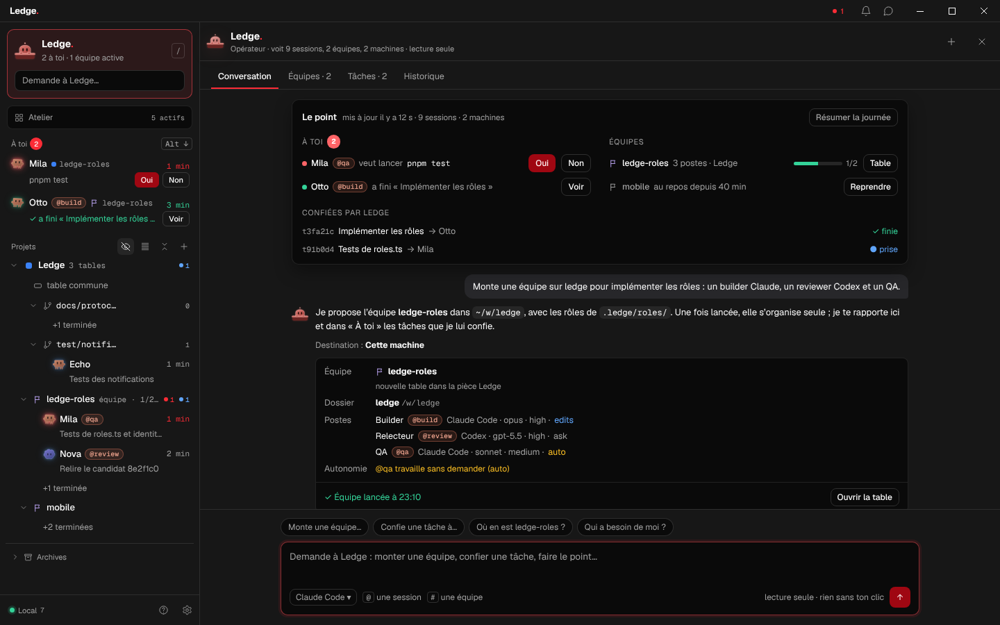
  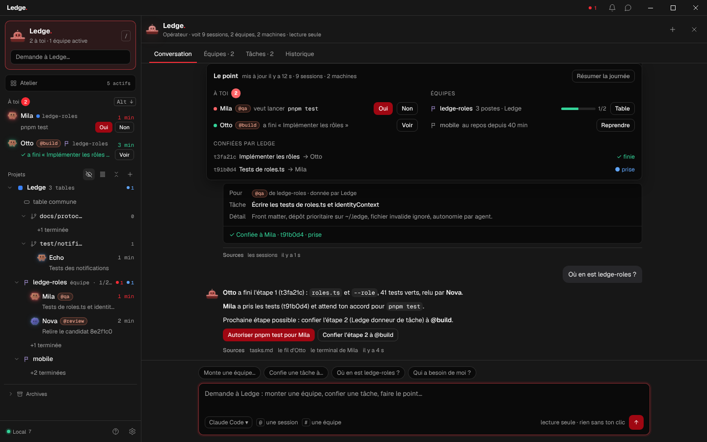

  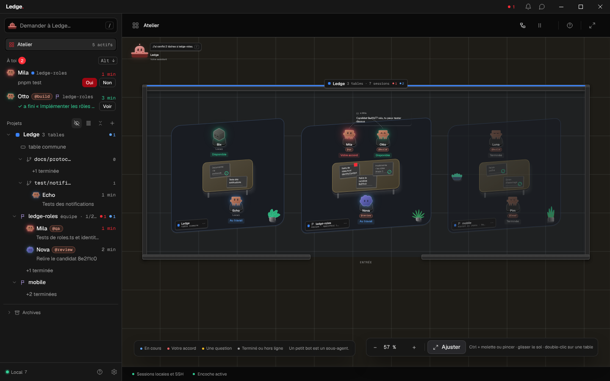
  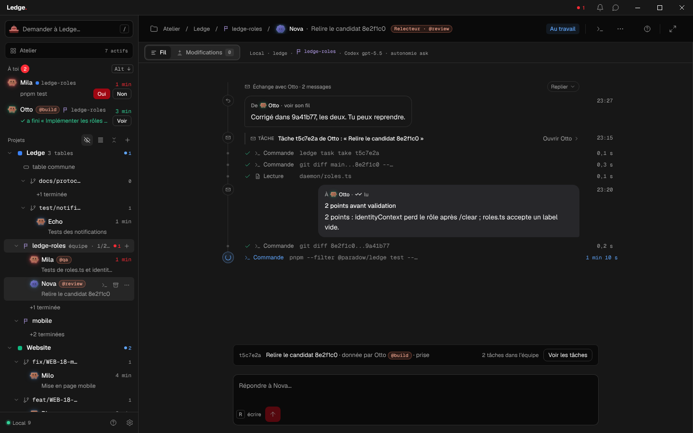

  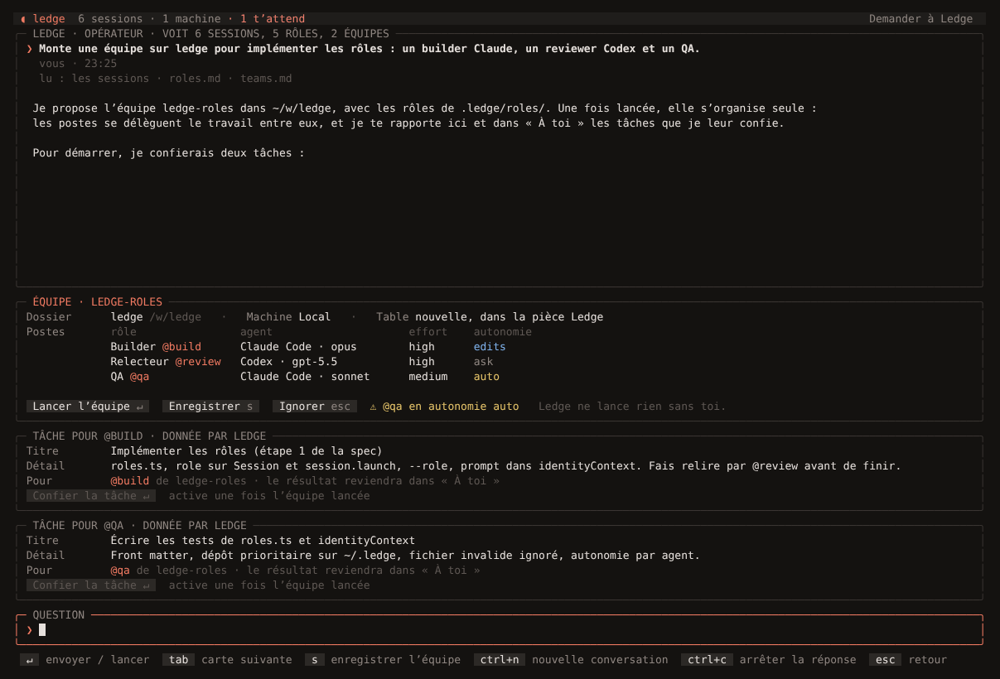
  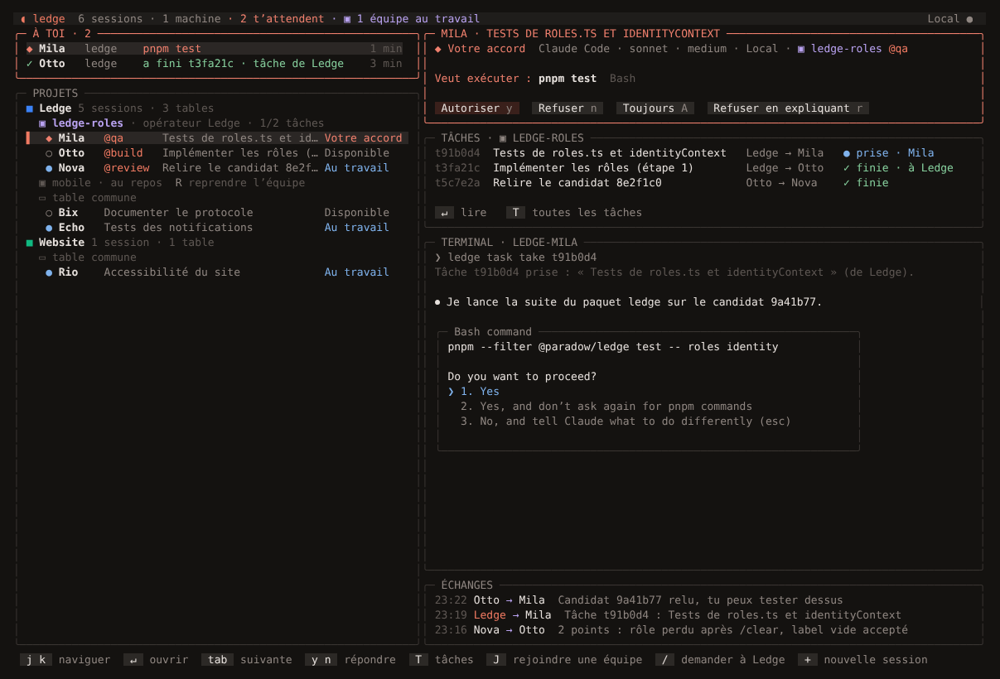
  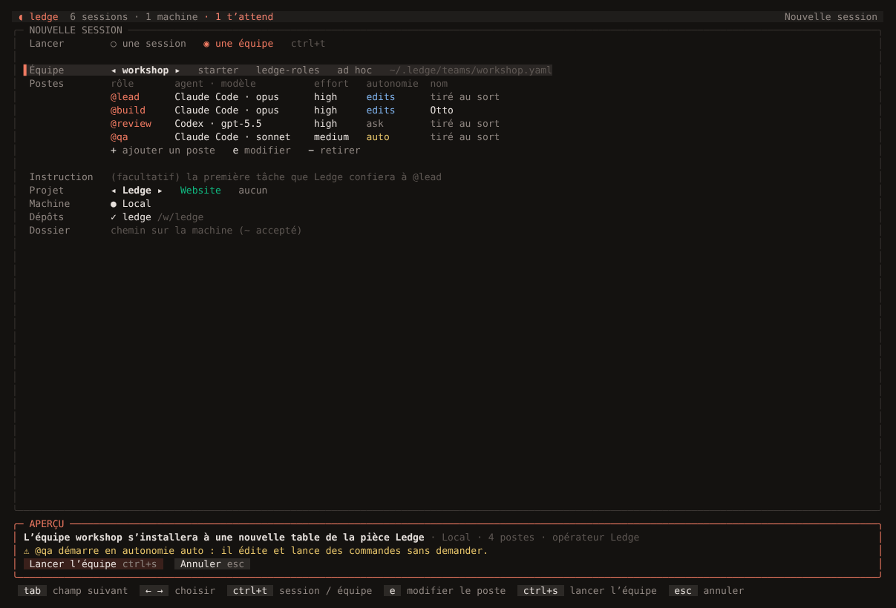

  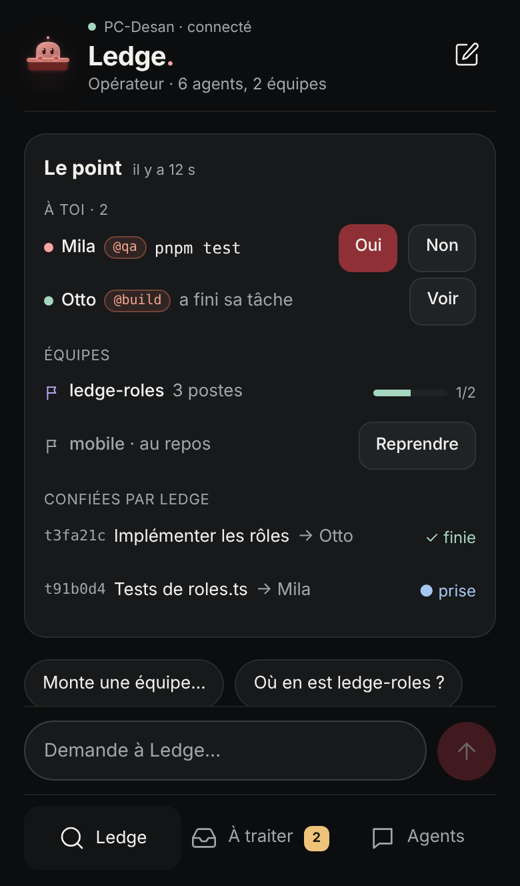
  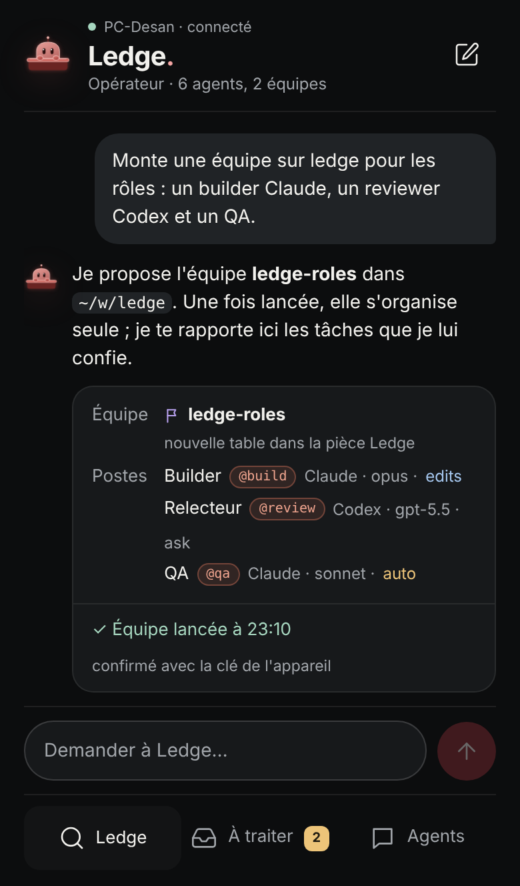
  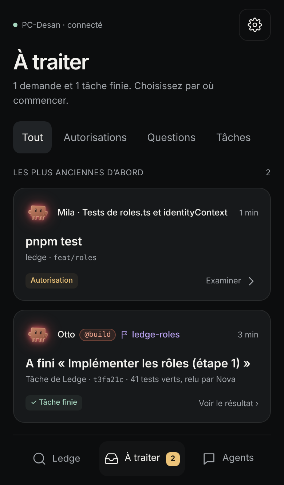
  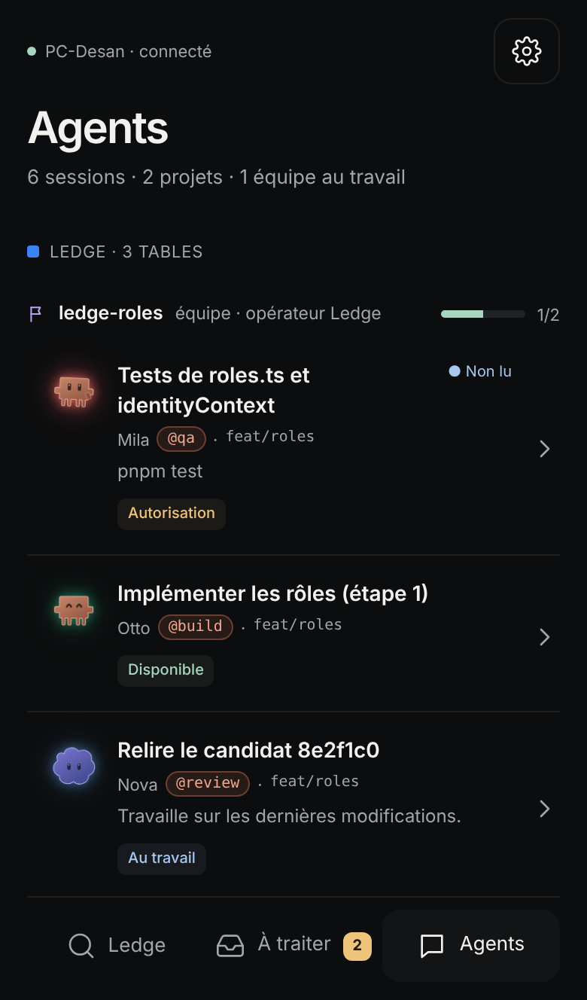

## 1. What exists

- **Sessions**: one agent in a tmux pane, registered with the daemon, followed by its hooks and its pane. A session has
  an id, a bot name, a project, a topic, a state and its helpers (subagents).
- **Projects**: a name, a colour, repositories and folder rules. The atelier draws one table per project.
- **Messages** (`ledge send`, Claude's `SendMessage`): typed at the receiver's next free moment, journaled in
  `~/.ledge/mail.json`, failures told to the sender.
- **Tasks** (`ledge task give|take|done|refuse|pass`): a giver, an owner, a state and a result, journaled in
  `~/.ledge/tasks.json`; every change is typed to the other side as a `<ledge-task>` line. The giver is always a session.
- **Ask Ledge**: a read-only harness run over a context folder (`sessions.md`, panes, replies, git, projects, forge). It
  answers, and proposes cards (`ledge-session`, `ledge-relay`, `ledge-close`, `ledge-project`) that the user clicks.
- **Identity**: at each `SessionStart` the hook tells the agent its name, project and branch and how to reach the
  others (`identityContext`).

## 2. What is new

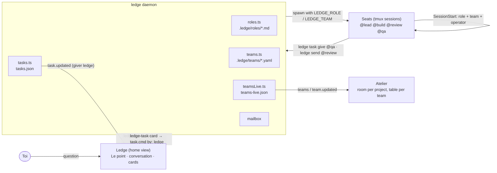

1. **Roles** are Markdown files with a prompt and launch defaults. A seat is told its role and its team at every start.
2. **Teams**: a template is a file; a **live team** is a daemon record bound to one project, with its seats, its table,
   and a life of its own (active, resting, dissolved), which can be joined, left and resumed.
3. **Ledge is the operator**: it proposes a team and the first tasks as cards. Once launched, the seats delegate among
   themselves with `@role`, without cards. The tasks Ledge gave come back to the user (« À toi », « Le point »,
   phone); the tasks seats give each other stay between them.
4. **The atelier** draws a room per project with low walls; each team has its own table, the other sessions sit at the
   common table.
5. **The home view** is Ledge: « Le point » (what waits for you, the teams, the tasks Ledge gave) above the conversation.

## 3. Protocol summary

Client → daemon: `roles.list`, `team.launch`, `team.join`, `team.leave`, `team.resume`, `team.dissolve`;
`session.launch` gets `role` and `team`; `task.cmd` accepts `by: 'ledge'` and `team` on `list`.

Daemon → clients: `roles.listing`, `teams`, `team.updated`, `team.launched`, `team.failed`, `task.updated`.

Session model: `role?`, `roleLabel?`, `team?`. Context folder: `roles.md`, `teams.md`, `tasks.md`. Card blocks:
`ledge-team`, `ledge-task`.

## 4. Order of work

1. Roles. 2. Ledge as a giver. 3. Live teams and the team card. 4. `@role` and autonomy. 5. Atelier rooms.
6. Ledge home. Each step ships on its own and is useful by itself.
