# Ledge, a tour

Ledge is a handle on the left edge of your Windows screen. Every agent you start from WSL2 with `ledge claude`, or from the handle itself, gets a mascot in it. When an agent needs you, its mascot lights up, a bubble unfolds, and you answer from there. The terminal tab is one click away when you want the whole conversation.

All captures below are the real overlay, in French (its default language, English is one toggle away), running against simulated sessions. Dark theme "Signal" unless noted; the light theme is "Galet".

## The handle

Ledge's own mascot sits on top of the handle, grey with a peach antenna light, the same one as the app and tray icon. It stays there with or without sessions: it follows your cursor with its eyes, and a click on it opens the list. Below it, four sessions, four mascots. Each one wears the colour of its state: red for a permission to give, amber for a question, blue for an agent at work, green for one waiting for your next instruction. A mascot that waits for you breathes.

<p>
  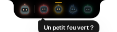
  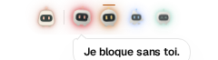
</p>

**The handle lives.** A working bot hops every 3.6 to 4.4 s, 2 px high in the handle, so you can tell a bot that works from one that waits without opening anything. Under reduced motion the antenna light pulses instead.

## The bubble

When an agent asks something, the bubble unfolds beside the handle for a few seconds with the request and the two answers. "+1 autre" means another ask is queued behind it. Nothing steals your focus: you keep typing wherever you were, and the bubble folds back on its own.

<p>
  
  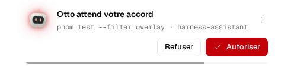
</p>

**Finished.** When a bot ends its turn, it grows in the handle and a bubble says "Otto finished · 2m 40s of work · harness-assistant" for 6 s, with OK and Open. A request always comes before a notice. Settings › "When a bot finishes" chooses bubble, sound, both or the handle only.

## The list

Resting the cursor on the handle, or pressing `Ctrl+Alt+L` from anywhere, opens the list. A list opened by hovering folds back when the cursor leaves it, unless you are typing in one of its fields; a click anywhere outside an open panel folds it too. Rows are grouped by repository. Line 1 of a row is the topic (what the agent is working on), line 2 is the bot's name · branch · age, with the badge for the state on the right. Rename the topic from the session header (an empty name hands back to the conversation title, then the first prompt). Asks come first, oldest on top with the red bar.

<p>
  
  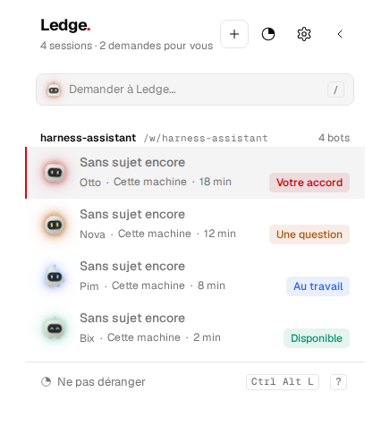
</p>

It scales to a busy day: twelve sessions scroll inside the panel, with the count of asks in the subtitle.

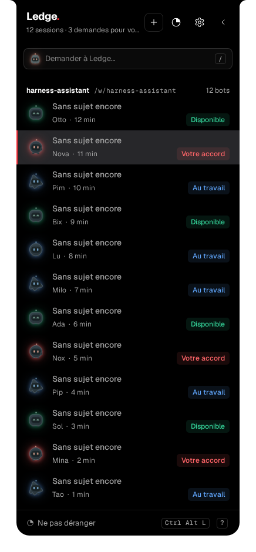

## Asking Ledge

Above the sessions, matching the notch's mascot above the bots, the "Demander à Ledge" field takes a question about your sessions, for example "Où en sont les autres ?". `/` focuses it from the list, `Enter` sends it. `Enter` on the empty field, or a click on the field's mascot, opens today's conversation without asking. The chat view opens: first the steps (the terminals, replies and repositories Ledge reads), then the answer writing itself live, with its sources underneath and the bots' names as links that open their session. A second question resumes the same conversation, one per day. `+` in the chat header starts a new one. Settings › Display › "Harnais par défaut" chooses which tool answers (Claude Code, Codex or Cursor Agent); new sessions open on the same choice. Ledge only reads: it never touches anything and never sends an instruction to a session.

## Starting a session from Ledge

The `+` in the header (or the button of an empty list) opens "Nouvelle session": the folder (typed, or one of the recent ones, with who already works there), the tool, the companion's name (a die picks another), an optional first instruction, and two options: resume the folder's last conversation, open the terminal tab. The folder button next to the field browses the WSL folders: a breadcrumb back up, the subfolders one level at a time, "Nouveau dossier" to make one in place (a new project), "Choisir ce dossier" to fill the field; what was typed in the rest of the form stays. Entrée starts it. The session appears in the list at once with the Démarrage badge, a line says so for a few seconds, and the terminal tab is one click away when it was not opened straight away.

<p>
  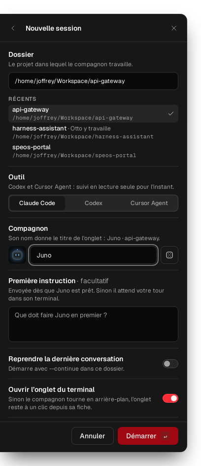
  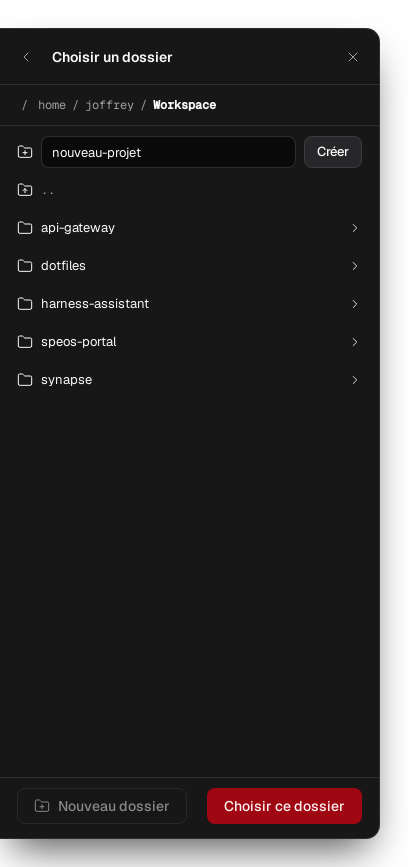
  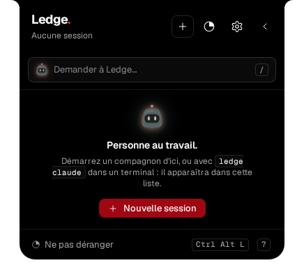
</p>

## Answering from Ledge

Opening a row shows the session. A permission request shows the command and where it runs, with Refuser and Autoriser (`N` and `Y` on the keyboard). The daemon types the answer into the agent's terminal and confirms only once the prompt is gone. The terminal preview folds under the card; the field at the bottom sends an instruction to the agent when it is your turn.

<p>
  
  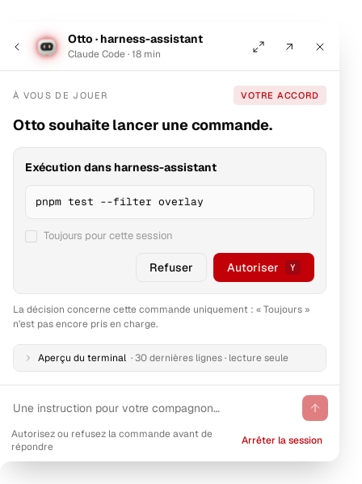
</p>

A question from the agent shows its options as cards. Pick one and send; free text is not supported yet for a question, Ledge says so and points you to the terminal. Several questions in one `AskUserQuestion` arrive one dialog at a time, then a review ("Ready to submit your answers?"): answering the first so the next appears is success, not a failed answer.

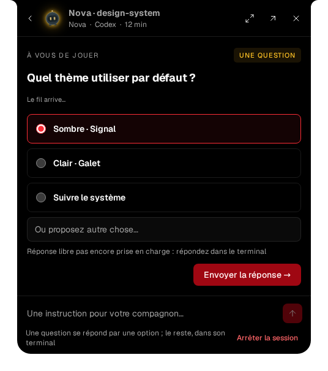

## When the agent hands back to you

When a turn ends, the agent's last message is read like a plan instead of being left in the terminal: a title, a lead, then its sections with their markers. What was done gets a green check per item, verifications read in monospace, an open question becomes a card with the options the agent proposed as chips, and what is left to do sits in a dashed box. Ordinary lists follow the markdown: a `-` list is bullets (`·`), a `1.` list is `1.` `2.` `3.`, not numbered cards. A chip fills the reply field, `Enter` sends it; with several questions, each chip writes its own numbered line. The "Réponse complète, telle quelle" toggle shows the text as the agent wrote it, and the terminal preview folds underneath. The session page is 480 px so the header actions keep their hit area; reading the raw reply widens it to 560 px.

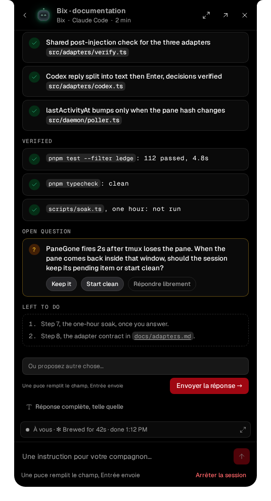

The text comes from the `Stop` hook of Claude Code (its `last_assistant_message`), so it is the real message, not a capture of the pane. A reply without headings or lists still shows as readable prose.

## Reading a cited Markdown file

Click a `.md` or `.markdown` reference in an agent reply or in Ledge's chat. Ledge opens the file in the same panel, at 560 px or 800 px when expanded. The reader has a collapsible table of contents, a rendered view and a Markdown source view. Links to another local Markdown file open inside the reader; Back walks through those documents before returning to the original conversation. The reply and any draft remain in place. Escape goes back; the close button folds the panel to the handle.

The WSL daemon reads a regular UTF-8 Markdown file, up to 1 MiB, from the session's working directory or an absolute WSL path. Relative paths in the Ledge chat need a known source and otherwise show a clear error. The reader does not edit files or send decisions to agents. HTML and images in documents remain inert. Reload explicitly reads the file again. Windows drive paths and `file:` links are outside this first version. The browser flow is covered by `apps/overlay/e2e/document-reader.spec.ts`; native Windows display and DPI validation remains to be done.

## Following an agent at work

A working session shows the terminal preview: the last thirty lines of the conversation, kept on the latest line as the agent writes. From here you can interrupt the turn, stop the session, or jump to its terminal tab.

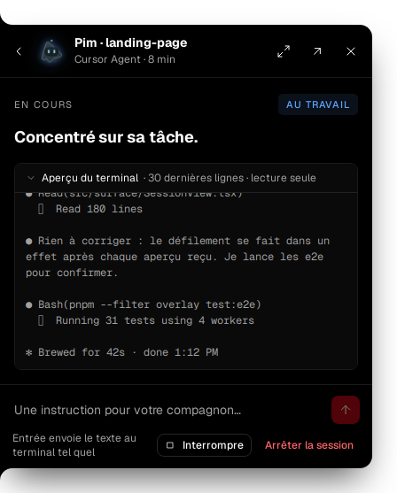

When the agent hands part of the work to subagents, they appear under the title as small bots with their task and their state. A session whose main thread is only waiting for its subagents stays "au travail" in the list, the handle and the bubble, instead of reading as available.

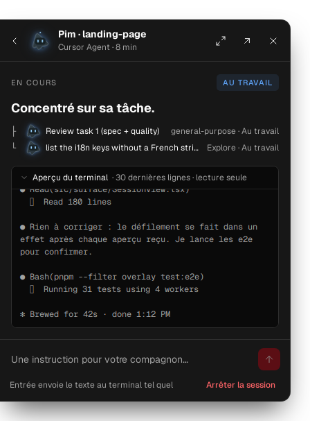

A session started with plain `claude`, without the launcher, is still visible through its hooks, in read-only mode.

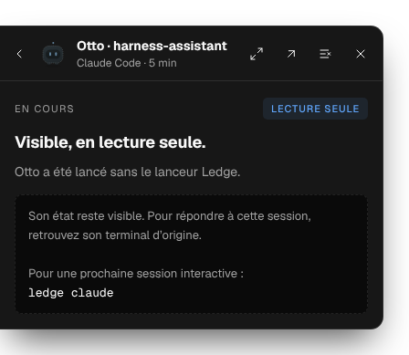

## Keyboard first

`Ctrl+Alt+L` opens the list on the oldest ask. `J` and `K` move, `Alt ←` and `Alt →` go to the previous or next session (from an open session too), `Y` and `N` decide, digits choose a question's option, `Enter` opens, `Escape` goes back then folds. `Ctrl+Alt+N` opens the new-session form from anywhere. The first three keyboard opens show a coachmark; `?` opens the full list of shortcuts at any time.

<p>
  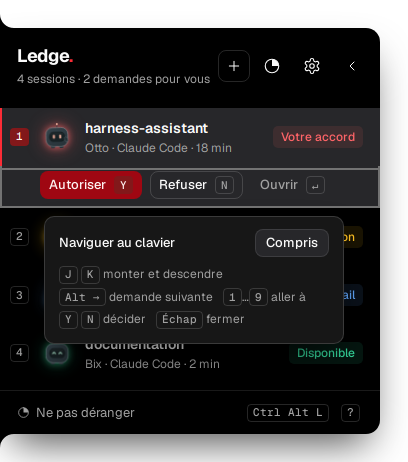
  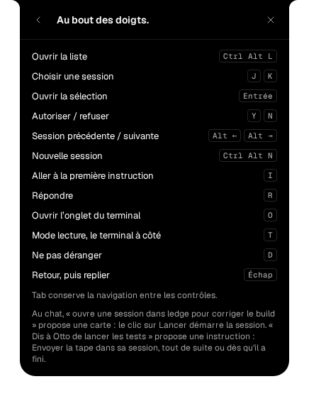
</p>

## Settings

Three tabs, the last one opened remembered. Display: language, the default harness (new sessions and the Ledge chat), the screen the handle sits on, the size of the handle and of the windows (auto or 100 to 200 percent), the theme (`Ctrl+Alt+T`) and reduced motion. Notifications: do-not-disturb and when a bot finishes (bubble and sound, bubble, sound, or handle only). Sounds: everything below.

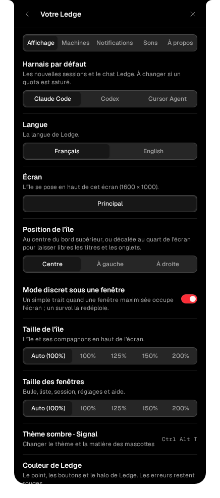

**Sounds.** Eight short synthesised cues, one family: asks rise or knock, results fall, your own decisions tick. Settings › Sounds has the switch, the volume with a Test button, one checkbox per category, and "Only when the terminal is behind", which keeps Ledge quiet while Windows Terminal is the front window. Do not disturb silences everything.

## Refreshing these captures

They come from `apps/overlay/e2e/screenshots.spec.ts`, which drives the real app against the fake daemon used by the end-to-end tests:

```sh
LEDGE_SCREENSHOTS=1 pnpm --filter overlay exec playwright test e2e/screenshots.spec.ts
```

Set `LEDGE_CHROMIUM=/path/to/chrome` when the Playwright build pinned by the project is not installed. The web fonts are fetched for real, so it needs network access.
