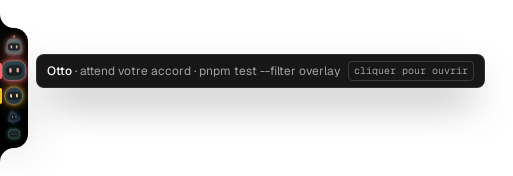

# Ledge, a tour

Ledge is a handle on the left edge of your Windows screen. Every agent you start from WSL2 with `ledge claude` gets a mascot in it. When an agent needs you, its mascot lights up, a bubble unfolds, and you answer from there. The terminal tab is one click away when you want the whole conversation.

All captures below are the real overlay, in French (its default language, English is one toggle away), running against simulated sessions. Dark theme "Signal" unless noted; the light theme is "Galet".

## The handle

Four sessions, four mascots. Each one wears the colour of its state: red for a permission to give, amber for a question, blue for an agent at work, green for one waiting for your next instruction. A mascot that waits for you breathes.

<p>
  
  
</p>

Hovering a mascot tells you who it is and what it waits for.



**The handle lives.** A working bot hops every 3.6 to 4.4 s, 2 px high in the handle, so you can tell a bot that works from one that waits without opening anything. Under reduced motion the antenna light pulses instead.

## The bubble

When an agent asks something, the bubble unfolds beside the handle for a few seconds with the request and the two answers. "+1 autre" means another ask is queued behind it. Nothing steals your focus: you keep typing wherever you were, and the bubble folds back on its own.

<p>
  
  
</p>

**Finished.** When a bot ends its turn, it grows in the handle and a bubble says "Otto finished · 2m 40s of work · harness-assistant" for 6 s, with OK and Open. A request always comes before a notice. Settings › "When a bot finishes" chooses bubble, sound, both or the handle only.

## The list

Resting the cursor on the screen edge, or pressing `Ctrl+Alt+L` from anywhere, opens the list. One row per session: project, mascot name, tool and age, and a badge for the state. Asks come first, oldest on top with the red bar. The header has do-not-disturb, settings and collapse; the footer shows the shortcut.

<p>
  
  
</p>

It scales to a busy day: twelve sessions scroll inside the panel, with the count of asks in the subtitle.


## Answering from Ledge

Opening a row shows the session. A permission request shows the command and where it runs, with Refuser and Autoriser (`N` and `Y` on the keyboard). The daemon types the answer into the agent's terminal and confirms only once the prompt is gone. The terminal preview folds under the card; the field at the bottom sends an instruction to the agent when it is your turn.

<p>
  
  
</p>

A question from the agent shows its options as cards. Pick one and send; free text is not supported yet for a question, Ledge says so and points you to the terminal.


## Following an agent at work

A working session shows the terminal preview: the last thirty lines of the conversation, kept on the latest line as the agent writes. From here you can interrupt the turn, stop the session, or jump to its terminal tab.


A session started with plain `claude`, without the launcher, is still visible through its hooks, in read-only mode.


## Keyboard first

`Ctrl+Alt+L` opens the list on the oldest ask with the rows numbered. `J` and `K` move, a digit jumps, `Y` and `N` decide, `Enter` opens, `Escape` goes back then folds. The first three keyboard opens show a coachmark; `?` opens the full list of shortcuts at any time.

<p>
  
  
</p>

## Settings

Language, the screen the handle sits on, the size of the handle and of the windows (auto or 100 to 200 percent), do-not-disturb, reduced motion, and the theme (`Ctrl+Alt+T`).


**Sounds.** Eight short synthesised cues, one family: asks rise or knock, results fall, your own decisions tick. Settings › Sounds has the switch, the volume with a Test button, one checkbox per category, and "Only when the terminal is behind", which keeps Ledge quiet while Windows Terminal is the front window. Do not disturb silences everything.

## Refreshing these captures

They come from `apps/overlay/e2e/screenshots.spec.ts`, which drives the real app against the fake daemon used by the end-to-end tests:

```sh
LEDGE_SCREENSHOTS=1 pnpm --filter overlay exec playwright test e2e/screenshots.spec.ts
```

Set `LEDGE_CHROMIUM=/path/to/chrome` when the Playwright build pinned by the project is not installed. The web fonts are fetched for real, so it needs network access.
